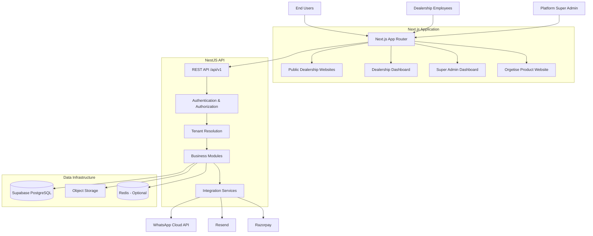
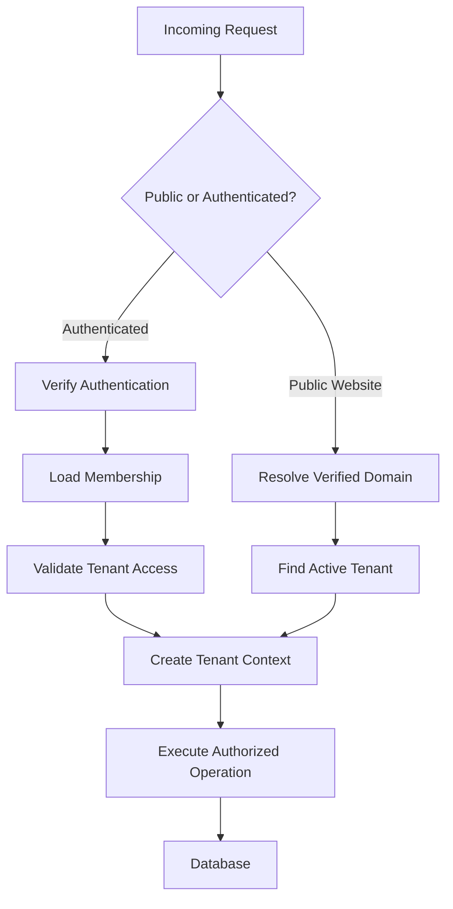
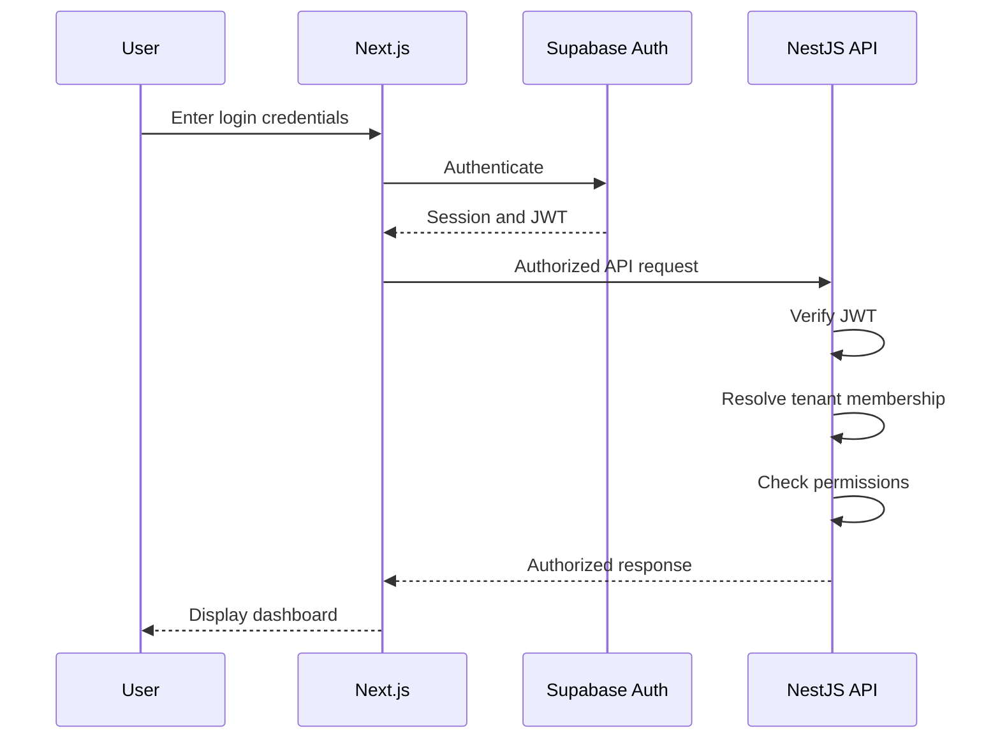
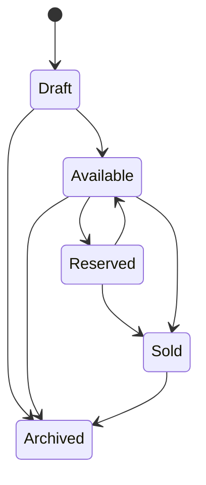
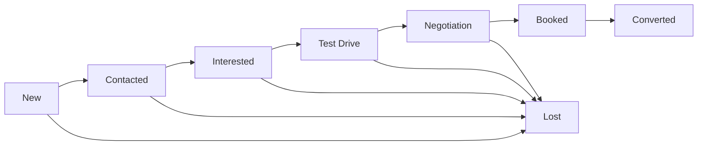
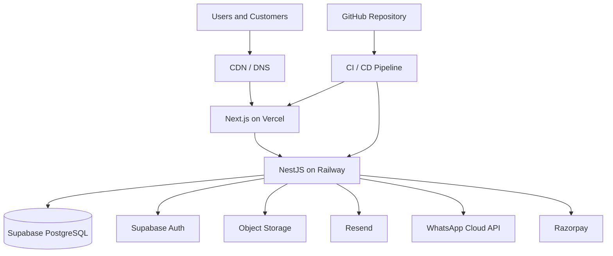

# SYSTEM ARCHITECTURE DOCUMENT
# Orgetise — Pre-Owned Automobile Dealership SaaS

**Document:** `docs/ARCHITECTURE.md`  
**Organization:** Orgetise Technologies Pvt. Ltd.  
**Product:** Multi-Tenant Automobile Dealership Management SaaS  
**Version:** 1.0  
**Status:** Proposed Architecture  
**Architecture Style:** Modular Monolith + Multi-Tenant Architecture  
**Primary Market:** India  
**Primary Currency:** INR (₹)

---

# 1. ARCHITECTURE OVERVIEW

## 1.1 Purpose

This document defines the technical architecture of the Orgetise Pre-Owned Automobile Dealership SaaS platform.

It establishes how the system is structured, how its components communicate, how data is stored, how tenants are isolated, and how the application can scale as the number of dealerships increases.

This document serves as the primary technical reference for:

- AI coding agents.
- Software architects.
- Frontend developers.
- Backend developers.
- Database engineers.
- DevOps engineers.
- QA engineers.

All implementation decisions should remain consistent with this document or be recorded as an approved architectural change.

## 1.2 Product definition

Orgetise is a multi-tenant SaaS platform that provides pre-owned automobile dealerships with:

1. Independent branded dealership websites.
2. Vehicle inventory management.
3. Customer relationship management.
4. Lead management.
5. Sales and purchase management.
6. Employee and branch management.
7. Business analytics.
8. Subscription management.
9. Custom domain management.
10. Centralized platform administration.

## 1.3 Architectural objectives

The architecture must provide:

| Objective | Architectural requirement |
|---|---|
| Multi-tenancy | Multiple dealerships on shared infrastructure |
| Security | Strict tenant data isolation |
| Scalability | Support growth from initial customers to thousands of dealerships |
| Maintainability | Modular and clearly separated business domains |
| Performance | Optimized public websites and administrative dashboards |
| Reliability | Consistent error handling and transaction management |
| Extensibility | Integrations through independent service adapters |
| Reusability | Shared application and infrastructure |
| Cost efficiency | Avoid unnecessary infrastructure and microservices |
| Customization | Independent dealership branding and domains |

---

# 2. HIGH-LEVEL SYSTEM ARCHITECTURE

## 2.1 Architecture pattern

The application follows a modular monolithic architecture.

A single NestJS backend application contains independently organized business modules.

The frontend is a Next.js application serving:

- Orgetise product website.
- Public dealership websites.
- Dealership administration dashboards.
- Platform administration dashboard.

The backend provides centralized APIs and business logic.

PostgreSQL is the primary source of truth.

## 2.2 System architecture diagram



## 2.3 Architectural principle

All dealerships share the same application codebase and infrastructure.

However, their business data, users, configurations, branding and operations remain logically isolated.

Example:

- Royal Drive uses the platform.
- Premium Motors uses the platform.
- City Cars uses the platform.

Each dealership operates independently without requiring a separate application deployment.

---

# 3. TECHNOLOGY STACK

## 3.1 Frontend architecture

| Technology | Responsibility |
|---|---|
| Next.js | Application framework |
| React | Component-based UI |
| TypeScript | Type safety |
| Tailwind CSS | Styling |
| App Router | Routing and layouts |
| React Server Components | Server-side rendering |
| Client Components | Interactive interfaces |
| Shared UI package | Reusable components |
| Zod | Runtime validation where appropriate |

### Frontend responsibilities

- Render dealership websites.
- Render dealership dashboards.
- Render the platform administration dashboard.
- Handle user interactions.
- Manage client-side state where necessary.
- Submit validated requests to the backend.
- Display API responses.
- Provide loading, error and empty states.
- Support responsive layouts.

The frontend must not contain privileged business logic.

## 3.2 Backend architecture

| Technology | Responsibility |
|---|---|
| NestJS | Backend framework |
| Node.js | Runtime |
| TypeScript | Type safety |
| REST | API communication |
| PostgreSQL | Persistent data |
| Supabase Auth | Authentication |
| DTOs | Request validation |
| Guards | Authentication and authorization |
| Interceptors | Request processing |
| Exception filters | Centralized error handling |

### Backend responsibilities

- Authentication verification.
- Tenant resolution.
- Authorization.
- Business rules.
- Database operations.
- Inventory management.
- CRM operations.
- Sales processing.
- Subscription enforcement.
- Integration management.
- Audit logging.

NestJS is the authoritative business logic layer.

## 3.3 Database and storage

| Technology | Responsibility |
|---|---|
| PostgreSQL | Primary relational database |
| Supabase | Managed database and authentication infrastructure |
| PostgreSQL RLS | Tenant data protection |
| Supabase Storage / Cloudflare R2 | Vehicle media and documents |
| Redis | Optional caching and background processing |

PostgreSQL is the source of truth for business information.

Object storage is used for binary files, images and documents.

Do not store large image or video files directly inside PostgreSQL.

---

# 4. APPLICATION STRUCTURE

## 4.1 Monorepo architecture

Use pnpm workspaces and Turborepo.

Recommended repository structure:

```text
dealer-saas/
│
├── AGENTS.md
├── README.md
├── package.json
├── pnpm-workspace.yaml
├── turbo.json
├── .gitignore
├── .env.example
│
├── apps/
│   │
│   ├── web/
│   │   ├── app/
│   │   │   ├── (marketing)/
│   │   │   │   ├── page.tsx
│   │   │   │   ├── about/
│   │   │   │   ├── pricing/
│   │   │   │   └── contact/
│   │   │   │
│   │   │   ├── (auth)/
│   │   │   │   ├── login/
│   │   │   │   ├── register/
│   │   │   │   └── forgot-password/
│   │   │   │
│   │   │   ├── (dealer-site)/
│   │   │   │   ├── page.tsx
│   │   │   │   ├── inventory/
│   │   │   │   ├── vehicles/
│   │   │   │   ├── about/
│   │   │   │   └── contact/
│   │   │   │
│   │   │   ├── dashboard/
│   │   │   │   ├── overview/
│   │   │   │   ├── inventory/
│   │   │   │   ├── leads/
│   │   │   │   ├── customers/
│   │   │   │   ├── sales/
│   │   │   │   ├── purchases/
│   │   │   │   ├── employees/
│   │   │   │   ├── branches/
│   │   │   │   ├── analytics/
│   │   │   │   └── settings/
│   │   │   │
│   │   │   └── super-admin/
│   │   │       ├── overview/
│   │   │       ├── dealerships/
│   │   │       ├── subscriptions/
│   │   │       └── platform-settings/
│   │   │
│   │   ├── components/
│   │   ├── features/
│   │   ├── hooks/
│   │   ├── lib/
│   │   └── public/
│   │
│   └── api/
│       └── src/
│           ├── main.ts
│           ├── app.module.ts
│           │
│           ├── common/
│           │   ├── decorators/
│           │   ├── guards/
│           │   ├── interceptors/
│           │   ├── filters/
│           │   ├── pipes/
│           │   └── middleware/
│           │
│           ├── config/
│           ├── database/
│           ├── auth/
│           ├── tenants/
│           ├── memberships/
│           ├── users/
│           ├── roles/
│           ├── permissions/
│           ├── branches/
│           ├── inventory/
│           ├── media/
│           ├── leads/
│           ├── customers/
│           ├── crm/
│           ├── test-drives/
│           ├── purchases/
│           ├── sales/
│           ├── employees/
│           ├── analytics/
│           ├── notifications/
│           ├── subscriptions/
│           ├── billing/
│           ├── domains/
│           ├── audit-logs/
│           └── integrations/
│
├── packages/
│   ├── ui/
│   ├── types/
│   ├── validators/
│   ├── config/
│   └── tsconfig/
│
└── docs/
    ├── ARCHITECTURE.md
    ├── DATABASE.md
    ├── SECURITY.md
    ├── API.md
    ├── MULTI_TENANCY.md
    └── DECISIONS/
```

This is the target structure, not a requirement to create every folder immediately.

Only introduce directories when the corresponding functionality is implemented.

## 4.2 Package responsibilities

### apps/web

Contains all frontend applications and route groups.

### apps/api

Contains the backend API and business logic.

### packages/ui

Reusable frontend design system.

### packages/types

Shared TypeScript types and API contracts.

### packages/validators

Reusable validation schemas where frontend and backend share validation requirements.

### packages/config

Shared configuration for linting, formatting and TypeScript.

Avoid circular dependencies between packages.

---

# 5. FRONTEND ROUTING ARCHITECTURE

The frontend serves three different product experiences.

## 5.1 Orgetise product website

Purpose: Marketing and customer acquisition.

Example:

- `orgetise.com`
- `www.orgetise.com`

Pages:

- Home
- Product
- Features
- Pricing
- About
- Contact
- Login
- Register

This is the public website for the SaaS product itself.

## 5.2 Dealership public websites

Each dealership receives its own website.

Examples:

- `royaldrive.in`
- `premiummotors.in`
- `citycars.in`

Possible URL structure:

```text
/
├── /inventory
├── /vehicles/[slug]
├── /about
├── /contact
└── /privacy-policy
```

All public pages must resolve the correct dealership before loading business data.

## 5.3 Dealership administration

Example:

`app.orgetise.com/dashboard`

Possible pages:

```text
/dashboard
├── overview
├── inventory
│   ├── all
│   ├── add
│   ├── [vehicleId]
│   └── categories
├── leads
├── customers
├── test-drives
├── purchases
├── sales
├── employees
├── branches
├── analytics
├── settings
└── subscription
```

The selected tenant must be derived from authenticated membership and validated by the backend.

## 5.4 Platform administration

Example:

`app.orgetise.com/super-admin`

Responsibilities:

- Dealership management.
- Subscription management.
- Platform analytics.
- Tenant suspension.
- Usage monitoring.
- Support operations.
- Platform configuration.

Platform administrators must use separate platform-level permissions.

---

# 6. MULTI-TENANT ARCHITECTURE

## 6.1 Tenancy model

Use a shared database with shared tables and a tenant identifier.

This is a shared-schema, logical-isolation architecture.

Example:

```text
PostgreSQL Database
│
├── tenants
├── users
├── memberships
├── branches
├── vehicles
├── leads
├── customers
├── sales
└── subscriptions
```

Tenant-owned records are associated with the relevant dealership.

## 6.2 Tenant identification

Every dealership has a unique UUID.

Example:

```text
tenant_id:
550e8400-e29b-41d4-a716-446655440000
```

The backend resolves tenant context using:

1. Authenticated user identity.
2. Active dealership membership.
3. Verified dealership domain when resolving public websites.
4. Authorized platform administration context.

Tenant resolution must happen before tenant-owned database operations.

## 6.3 Tenant resolution flow



## 6.4 Tenant isolation

Every tenant-owned operation must validate the tenant context.

Example:

```text
GET /api/v1/inventory
```

The backend must derive the tenant from the authenticated request context.

Do not accept arbitrary tenant identifiers as authorization.

For database access:

- Apply tenant filters.
- Enforce database constraints.
- Apply RLS policies.
- Test unauthorized cross-tenant access.

## 6.5 Database security model

Use PostgreSQL Row Level Security.

The chosen database connection strategy must ensure that tenant context is established safely.

Preferred implementation:

1. Verify the user's authentication token.
2. Verify active membership.
3. Begin a database transaction.
4. Establish transaction-local tenant and user context.
5. Execute queries within that transaction.
6. Commit or roll back.
7. Ensure context cannot leak between pooled connections.

For example, tenant context can be established using transaction-local PostgreSQL settings and policies.

If using Supabase's authenticated client with the user's JWT, ensure RLS policies correctly validate the authenticated identity and tenant membership.

Do not assume that setting a request header or accepting a tenant ID is sufficient for RLS.

Important: Supabase service-role credentials bypass RLS. Restrict them to trusted server-side operations and never treat them as the default tenant-scoped database connection.

## 6.6 Cross-tenant relationship protection

Use composite constraints where appropriate.

For example:

A lead belonging to Tenant A must not reference a vehicle belonging to Tenant B.

Use database constraints or transactional checks to prevent invalid cross-tenant relationships.

---

# 7. AUTHENTICATION AND AUTHORIZATION ARCHITECTURE

## 7.1 Authentication provider

Use Supabase Auth for identity management.

Responsibilities:

- User registration.
- Login.
- Password recovery.
- Email verification.
- Session management.
- JWT issuance.

NestJS remains responsible for verifying tokens and enforcing business permissions.

## 7.2 Authentication flow



Use secure cookie-based session handling where appropriate.

Never store privileged tokens in insecure browser storage.

## 7.3 Role-based access control

Implement RBAC using:

- Roles
- Permissions
- User memberships
- Tenant context
- Branch-level restrictions where applicable

Example:

```text
Owner
├── Dashboard
├── Inventory
├── CRM
├── Sales
├── Purchases
├── Employees
├── Branches
├── Analytics
└── Subscription

Sales Executive
├── Assigned Leads
├── Customers
├── Test Drives
└── Authorized Vehicle Information
```

Permissions must be enforced by NestJS and supported by database-level protections.

---

# 8. BACKEND MODULE ARCHITECTURE

Use NestJS feature modules.

Each module should follow a consistent internal structure.

Example:

```text
inventory/
├── inventory.module.ts
├── inventory.controller.ts
├── inventory.service.ts
├── inventory.repository.ts
├── dto/
├── entities/
├── interfaces/
├── policies/
└── tests/
```

The repository layer is optional when its abstraction provides real value. Do not introduce unnecessary layers.

## 8.1 Module responsibilities

| Module | Responsibility |
|---|---|
| Auth | Authentication integration |
| Tenants | Dealership registration and lifecycle |
| Memberships | User-dealership relationships |
| Users | User profiles |
| Roles | Role definitions |
| Permissions | Access control |
| Branches | Multiple showroom locations |
| Inventory | Vehicle records and lifecycle |
| Media | Vehicle images and documents |
| Leads | Customer enquiries |
| Customers | Customer profiles |
| CRM | Follow-ups and activities |
| Test Drives | Test-drive scheduling |
| Purchases | Vehicle acquisitions |
| Sales | Vehicle sales and transactions |
| Employees | Dealership staff |
| Analytics | Business reporting |
| Notifications | Notification orchestration |
| Subscriptions | SaaS plans and entitlements |
| Billing | Payment and invoice records |
| Domains | Custom domain resolution |
| Audit Logs | Important activity history |
| Integrations | External provider adapters |
| Super Admin | Platform administration |

## 8.2 Business logic ownership

Controllers must remain thin.

Controllers:

- Receive requests.
- Validate inputs through DTOs and pipes.
- Apply guards.
- Call services.
- Return responses.

Services:

- Execute business logic.
- Enforce workflow rules.
- Coordinate repositories.
- Manage transactions.

Repositories:

- Handle data access where an explicit repository abstraction is useful.

External integrations must be implemented in dedicated adapters.

---

# 9. DATABASE ARCHITECTURE

## 9.1 Primary database

Use PostgreSQL as the primary relational database.

All important business information must be stored in PostgreSQL.

## 9.2 Main entity groups

### Platform entities

- tenants
- users
- memberships
- roles
- permissions
- role_permissions
- branches
- subscriptions
- plans
- invoices
- payments
- domains
- audit_logs

### Inventory entities

- vehicles
- vehicle_images
- vehicle_documents
- vehicle_features
- vehicle_status_history
- vehicle_categories

### CRM entities

- leads
- customers
- lead_activities
- lead_assignments
- follow_ups
- test_drives

### Financial entities

- purchases
- purchase_expenses
- sales
- sale_payments
- commissions

### Communication entities

- notifications
- notification_templates
- communication_logs

This is the logical entity inventory, not the finalized database schema.

The exact relationships, constraints, indexes, field types and deletion rules must be specified in `docs/DATABASE.md`.

## 9.3 Database conventions

- Use UUID primary keys where appropriate.
- Use `tenant_id` on tenant-owned records.
- Use foreign keys.
- Use indexes for common queries.
- Use `created_at` and `updated_at`.
- Use appropriate deletion and archival policies.
- Store timestamps in UTC.
- Use integer minor units or appropriate decimal types for financial values.
- Never use floating-point types for financial calculations.
- Use migrations for schema changes.

## 9.4 Transaction management

Use database transactions for operations involving multiple related records.

Examples:

- Vehicle purchase.
- Vehicle sale.
- Vehicle reservation.
- Payment recording.
- Subscription renewal.
- Commission generation.

Prevent inconsistent partial updates.

---

# 10. VEHICLE INVENTORY ARCHITECTURE

The inventory module manages the dealership's vehicle lifecycle.

## 10.1 Vehicle lifecycle



All state transitions must be validated by backend business rules.

## 10.2 Vehicle data categories

### Public information

- Brand
- Model
- Variant
- Year
- Fuel
- Transmission
- Kilometres
- Ownership
- Colour
- Selling price
- Images
- Description
- Features

### Internal information

- Purchase price
- Seller details
- Acquisition costs
- Inspection reports
- Repair expenses
- Internal notes
- Profit calculations

Public APIs must expose only approved public information.

## 10.3 Inventory operations

- Create vehicle.
- Update vehicle.
- Delete or archive vehicle.
- Upload media.
- Reorder media.
- Publish listing.
- Unpublish listing.
- Reserve vehicle.
- Mark vehicle sold.
- Transfer between authorized branches.

---

# 11. CRM AND LEAD ARCHITECTURE

## 11.1 Lead sources

Leads may originate from:

- Dealership website.
- Vehicle enquiry form.
- WhatsApp.
- Telephone.
- Manual employee entry.
- External advertising campaigns.
- Future third-party integrations.

All lead sources should use a common lead creation service.

## 11.2 Lead lifecycle



## 11.3 Lead management responsibilities

- Capture enquiries.
- Associate vehicle interest.
- Assign salespeople.
- Track status.
- Record activities.
- Schedule follow-ups.
- Track test drives.
- Record conversion.
- Record lost reasons.

Preserve important historical events.

---

# 12. PUBLIC WEBSITE ARCHITECTURE

## 12.1 Multi-domain system

One Next.js application must serve multiple dealership domains.

Example:

```text
royaldrive.in       -> Tenant A
premiummotors.in    -> Tenant B
citycars.in         -> Tenant C
```

The domain mapping is stored in PostgreSQL.

## 12.2 Domain resolution

When a visitor opens a dealership website:

1. Read the incoming hostname.
2. Normalize and validate the hostname.
3. Resolve the hostname against verified domain records.
4. Identify the active dealership.
5. Load the dealership's public configuration.
6. Fetch approved published inventory.
7. Render the corresponding dealership website.

Never trust arbitrary hostnames as tenant authorization.

Unknown, unverified or inactive domains must return an appropriate error page.

## 12.3 Custom domain lifecycle

Support:

- Domain registration in the platform.
- DNS verification.
- Domain ownership verification.
- Domain activation.
- SSL provisioning.
- Domain reassignment with appropriate authorization.
- Domain removal.

Use the hosting provider's supported custom-domain infrastructure.

## 12.4 Dealership customization

Each dealership may configure:

- Logo
- Brand colors
- Contact details
- Address
- Social links
- Homepage content
- Featured inventory
- Website theme
- SEO metadata

Store configuration per tenant.

Do not create a separate codebase for each dealership.

---

# 13. MEDIA AND FILE STORAGE ARCHITECTURE

## 13.1 Storage strategy

Use object storage for:

- Vehicle photographs.
- Inspection documents.
- Registration documents.
- Dealership logos.
- Other authorized attachments.

PostgreSQL stores metadata and object references.

## 13.2 Object organization

Recommended structure:

```text
storage/
└── tenants/
    └── {tenant_id}/
        ├── vehicles/
        │   └── {vehicle_id}/
        │       ├── original/
        │       └── optimized/
        │
        ├── documents/
        │
        └── branding/
```

The actual object storage key must be generated and validated by the backend.

## 13.3 Security

- Validate upload permissions.
- Validate file formats.
- Enforce file size limits.
- Use signed upload/download URLs.
- Separate public and private assets.
- Prevent unauthorized object access.
- Apply tenant-level storage quotas.

Vehicle images may be publicly accessible only when the associated listing is published and the asset is approved for public display.

Private documents must never be exposed through public URLs.

## 13.4 Image optimization

Implement:

- Responsive image variants.
- WebP and AVIF where supported.
- Thumbnail generation.
- CDN caching.
- Lazy loading.
- Appropriate image quality.

Avoid transferring original high-resolution photographs for every page request.

---

# 14. SUBSCRIPTION AND BILLING ARCHITECTURE

## 14.1 Subscription model

Dealerships subscribe to predefined plans.

Example:

```text
Starter
Growth
Business Pro
Enterprise
```

Each plan defines entitlements.

Potential limits:

- Active vehicles.
- Number of employees.
- Number of branches.
- Storage allowance.
- Monthly messaging allowance.
- Analytics capabilities.
- Custom domains.
- Advanced integrations.

## 14.2 Subscription enforcement

Subscription restrictions must be enforced by the backend.

The frontend may display plan limits, but it cannot be the security enforcement mechanism.

Example:

A dealership on Starter cannot create a 31st active vehicle if its plan permits only 30.

## 14.3 Payment architecture

Use a payment adapter.

Initial integration:

- Razorpay.

Potential future integrations:

- Other payment gateways.
- International payment providers.

Payment workflow:

1. Create payment order.
2. Initiate checkout.
3. Receive payment response.
4. Verify payment signature.
5. Process verified webhook events.
6. Update payment records.
7. Update subscription entitlements.
8. Generate invoice records.

Never activate a subscription solely because the browser reports successful payment.

Webhook processing must be authenticated and idempotent.

---

# 15. EXTERNAL INTEGRATION ARCHITECTURE

External integrations must be independent of core business logic.

## 15.1 Integration structure

```text
integrations/
├── whatsapp/
├── email/
├── payments/
├── analytics/
└── maps/
```

Each integration should expose a controlled internal interface.

## 15.2 WhatsApp

Use WhatsApp Business Cloud API where supported.

Responsibilities:

- Enquiry notifications.
- Follow-up notifications.
- Approved template messages.
- Relevant customer communication.

Respect WhatsApp policies and messaging permissions.

## 15.3 Email

Use Resend for transactional emails.

Examples:

- Account verification.
- Password recovery.
- Lead notifications.
- Subscription notifications.
- Billing communications.

## 15.4 Failure handling

External provider failures must not unnecessarily crash core application workflows.

Use:

- Timeouts.
- Retry policies.
- Idempotency.
- Structured logs.
- Background jobs where appropriate.

Do not retry non-idempotent operations blindly.

---

# 16. API ARCHITECTURE

## 16.1 API style

Use REST APIs with JSON request and response bodies.

Base URL:

```text
/api/v1
```

## 16.2 Endpoint organization

```text
/api/v1/
│
├── auth/
├── tenants/
├── users/
├── memberships/
├── branches/
├── inventory/
├── leads/
├── customers/
├── crm/
├── test-drives/
├── purchases/
├── sales/
├── employees/
├── analytics/
├── subscriptions/
├── billing/
├── domains/
├── notifications/
└── super-admin/
```

## 16.3 Response conventions

Use consistent response structures.

Example:

```json
{
  "success": true,
  "data": {},
  "meta": null
}
```

Example error:

```json
{
  "success": false,
  "error": {
    "code": "RESOURCE_NOT_FOUND",
    "message": "The requested resource was not found."
  }
}
```

Do not expose internal stack traces or sensitive database details.

## 16.4 Pagination

Use pagination for large collections.

Example:

```text
GET /api/v1/inventory?page=1&limit=20
```

Support filtering and sorting through validated query parameters.

---

# 17. CACHING AND PERFORMANCE ARCHITECTURE

## 17.1 Caching strategy

Use caching selectively.

Potential cache candidates:

- Public dealership configurations.
- Public vehicle listing pages.
- Published vehicle details.
- Static reference data.
- Frequently requested analytics summaries.

## 17.2 Tenant-aware caching

Every cached dealership resource must be scoped to the tenant and relevant domain.

Never use a generic cache key that could return one dealership's content to another dealership.

Invalidate affected cache entries when:

- Vehicle is updated.
- Vehicle is unpublished.
- Vehicle is sold.
- Dealership branding changes.
- Dealership domain changes.

## 17.3 Database performance

- Index tenant identifiers.
- Index frequently queried fields.
- Avoid N+1 queries.
- Paginate large datasets.
- Select only required columns.
- Review slow queries.
- Use appropriate connection pooling.

## 17.4 Background processing

Introduce a queue system when asynchronous workloads justify it.

Potential jobs:

- Image optimization.
- Email notifications.
- WhatsApp notifications.
- Report generation.
- Subscription reminders.
- Data exports.

Use Redis and a job processor such as BullMQ when required.

Do not introduce queue infrastructure before there is a concrete workload.

---

# 18. SECURITY ARCHITECTURE

Security must be implemented at multiple layers.

## 18.1 Security layers

```text
Internet
   |
   v
HTTPS / CDN / WAF
   |
   v
Next.js Application
   |
   v
NestJS Authentication
   |
   v
Authorization and Tenant Resolution
   |
   v
Business Logic
   |
   v
PostgreSQL RLS + Constraints
   |
   v
Tenant-Isolated Data
```

## 18.2 Security controls

- JWT verification.
- Role-based authorization.
- Tenant membership validation.
- PostgreSQL RLS.
- Input validation.
- Rate limiting.
- Secure file uploads.
- Secure cookies.
- CORS restrictions.
- CSRF protection where applicable.
- Webhook signature verification.
- Audit logging.
- Secret management.
- Dependency security checks.

## 18.3 Sensitive information

The following information must be protected:

- Customer personal information.
- Phone numbers.
- Email addresses.
- Registration documents.
- Vehicle acquisition prices.
- Internal profit information.
- Employee information.
- Payment records.
- Authentication credentials.

Implement appropriate access restrictions and retention policies.

---

# 19. DEPLOYMENT ARCHITECTURE

## 19.1 Initial deployment strategy

Use managed infrastructure to reduce operational overhead.

| Component | Recommended service |
|---|---|
| Frontend | Vercel |
| Backend | Railway |
| Database | Supabase PostgreSQL |
| Authentication | Supabase Auth |
| Vehicle media | Cloudflare R2 or Supabase Storage |
| Email | Resend |
| Payments | Razorpay |
| DNS | Domain provider / Cloudflare |
| Source control | GitHub |

These are initial deployment choices, not permanent infrastructure requirements.

## 19.2 Environment separation

Maintain:

```text
Development
    |
    v
Staging
    |
    v
Production
```

Each environment must have independent configuration and appropriate data separation.

Never use production credentials in local development.

## 19.3 Deployment diagram



## 19.4 Deployment requirements

- Automated builds.
- Environment validation.
- Database migrations.
- Health checks.
- Structured logs.
- Error monitoring.
- Backup strategy.
- Rollback procedure.

Never run unreviewed destructive migrations automatically against production.

---

# 20. MONITORING AND OBSERVABILITY

Implement observability from the beginning.

## Application monitoring

Track:

- API response times.
- Error rates.
- Failed authentication attempts.
- Database connection issues.
- Failed background jobs.
- Integration failures.

## Business monitoring

Track:

- Active dealerships.
- Active subscriptions.
- Active vehicles.
- New enquiries.
- Lead conversion.
- Storage consumption.
- API usage.

## Logging

Use structured logs.

Include appropriate request identifiers and tenant identifiers where safe.

Never log passwords, tokens, payment secrets or unnecessary customer personal information.

---

# 21. SCALABILITY STRATEGY

The architecture should scale incrementally.

## Stage 1: Initial launch

Target: 1–10 dealerships.

Infrastructure:

- One Next.js application.
- One NestJS application.
- One PostgreSQL database.
- Object storage.
- Basic monitoring.

Focus:

- Correct business workflows.
- Security.
- Data integrity.
- Product validation.

## Stage 2: Early growth

Target: 10–100 dealerships.

Improvements:

- Database indexing.
- Better query optimization.
- Caching.
- Background processing.
- CDN optimization.
- Monitoring and alerting.
- Automated backups.

## Stage 3: Expansion

Target: 100–500 dealerships.

Improvements:

- API horizontal scaling.
- Database connection management.
- Dedicated background workers.
- Advanced monitoring.
- Read optimization.
- Improved tenant usage analytics.

## Stage 4: Large-scale operations

Target: 500–1,000+ dealerships.

Evaluate:

- Database resource scaling.
- Read replicas where useful.
- Workload isolation.
- Dedicated reporting infrastructure.
- Advanced caching.
- Queue scaling.
- Partitioning for high-volume tables.
- Selective extraction of independently scalable services.

These are planning stages, not guaranteed capacity figures. Actual capacity must be established through load testing and production measurements.

## Scalability principle

Do not introduce microservices simply because the number of dealerships increases.

First optimize the modular monolith and its infrastructure.

Extract services only when justified by independent scaling, reliability or organizational requirements.

---

# 22. BACKUP AND DISASTER RECOVERY

The platform contains valuable dealership and customer information.

Implement:

- Automated database backups.
- Point-in-time recovery where supported.
- Storage backup or versioning.
- Documented recovery procedures.
- Periodic restore testing.
- Production incident procedures.

Define recovery point objectives (RPO) and recovery time objectives (RTO) based on business requirements.

Do not assume that having backups automatically means recovery has been tested.

---

# 23. ARCHITECTURAL DECISION RECORDS

Significant architectural changes must be documented.

Store ADRs in:

```text
docs/DECISIONS/
```

Suggested initial ADRs:

```text
ADR-001-modular-monolith.md
ADR-002-multi-tenant-database.md
ADR-003-supabase-authentication.md
ADR-004-postgresql-row-level-security.md
ADR-005-tenant-resolution.md
ADR-006-media-storage.md
ADR-007-custom-domain-routing.md
ADR-008-api-architecture.md
ADR-009-subscription-entitlements.md
ADR-010-background-processing.md
```

Each ADR should contain:

- Context.
- Decision.
- Alternatives considered.
- Consequences.
- Implementation status.

---

# 24. IMPLEMENTATION ORDER

Build the system in the following order.

## Phase 1 — Foundation

- Monorepo setup.
- Next.js configuration.
- NestJS configuration.
- Shared packages.
- Environment configuration.
- Database connectivity.
- Logging.
- Basic CI.

## Phase 2 — Identity and tenancy

- Supabase Auth.
- User profiles.
- Tenant registration.
- Memberships.
- Tenant resolution.
- Role-based access.
- RLS.
- Tenant isolation tests.

## Phase 3 — Dealership configuration

- Dealership onboarding.
- Dealership settings.
- Branding.
- Branch management.
- Domain configuration.

## Phase 4 — Inventory

- Vehicle schema.
- Vehicle CRUD.
- Media uploads.
- Vehicle lifecycle.
- Inventory filtering.
- Inventory permissions.

## Phase 5 — Public websites

- Tenant domain resolution.
- Dealership homepage.
- Vehicle listing.
- Vehicle details.
- Enquiry forms.
- SEO.
- Responsive layouts.

## Phase 6 — CRM

- Lead capture.
- Customer profiles.
- Lead assignment.
- Lead pipeline.
- Follow-ups.
- Activity history.

## Phase 7 — Sales and purchases

- Purchase management.
- Sales workflow.
- Booking.
- Payment records.
- Profit calculations.
- Commission management.

## Phase 8 — Employees and analytics

- Employee management.
- Permissions.
- Branch-level access.
- Dashboard analytics.
- Reports.

## Phase 9 — Subscription and billing

- Subscription plans.
- Entitlements.
- Payment gateway.
- Webhook processing.
- Invoices.
- Subscription enforcement.

## Phase 10 — Platform administration

- Super admin dashboard.
- Dealership administration.
- Subscription monitoring.
- Platform analytics.
- Usage monitoring.

## Phase 11 — Production readiness

- Security testing.
- Performance testing.
- Tenant isolation testing.
- Load testing.
- Backup verification.
- Monitoring.
- Production deployment.

---

# 25. ARCHITECTURAL RULES FOR AI CODING AGENTS

Every AI agent working on this repository must follow these rules.

1. Read this architecture document before making significant architectural changes.
2. Follow the modular monolith architecture.
3. Never introduce microservices without documented justification.
4. Never bypass tenant authorization.
5. Never trust browser-supplied tenant identifiers.
6. Never expose service-role credentials.
7. Keep business logic inside backend modules.
8. Keep public and private dealership information separate.
9. Use migrations for database changes.
10. Use transactions for multi-record financial operations.
11. Maintain shared API contracts.
12. Write tests for tenant isolation.
13. Update documentation when architecture changes.
14. Inspect existing implementation before creating new abstractions.
15. Do not invent undocumented infrastructure dependencies.
16. Do not claim an architectural feature is implemented until it exists and has been verified.

If implementation requirements conflict with this architecture, explain the conflict and propose an appropriate change.

---

# 26. FINAL ARCHITECTURAL PRINCIPLE

Orgetise must be engineered as a shared, multi-tenant dealership operating platform.

The system must provide each dealership with an independent business environment while sharing the same underlying software infrastructure.

The architecture must remain:

- Modular.
- Secure.
- Tenant-aware.
- API-driven.
- Database-consistent.
- Cost-conscious.
- Maintainable.
- Scalable.
- Extensible.

**Build one powerful platform. Give every dealership its own digital business ecosystem.**

---

END OF SYSTEM ARCHITECTURE DOCUMENT


dealer-saas/
├── AGENTS.md
├── README.md
│
├── docs/
│   ├── ARCHITECTURE.md
│   ├── DATABASE.md
│   ├── MULTI_TENANCY.md
│   ├── SECURITY.md
│   ├── API.md
│   ├── DESIGN_SYSTEM.md
│   ├── DEVELOPMENT.md
│   ├── DEPLOYMENT.md
│   └── DECISIONS/
│
├── apps/
│   ├── web/
│   └── api/
│
└── packages/
    ├── ui/
    ├── types/
    ├── validators/
    └── config/


apps/web/AGENTS.md	Frontend-specific instructions
apps/api/AGENTS.md	Backend-specific instructions