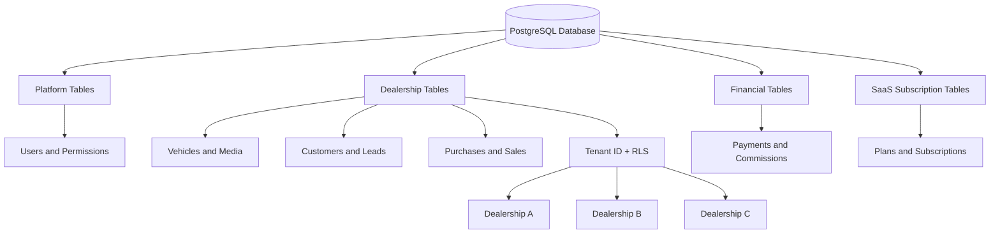
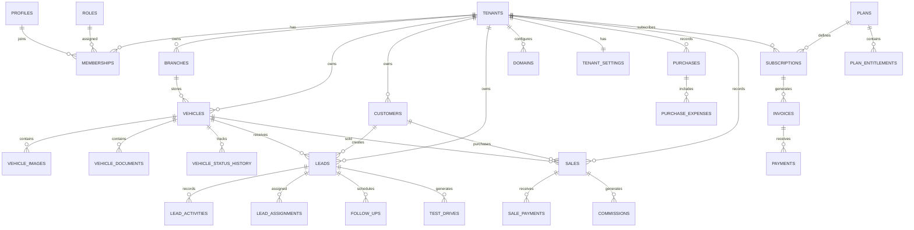

# DATABASE DESIGN DOCUMENT
# Orgetise — Pre-Owned Automobile Dealership SaaS

**Document:** `docs/DATABASE.md`  
**Organization:** Orgetise Technologies Pvt. Ltd.  
**Product:** Multi-Tenant Automobile Dealership Management SaaS  
**Version:** 1.0  
**Status:** Proposed Database Design  
**Database:** PostgreSQL  
**Infrastructure:** Supabase  
**Architecture:** Shared Database / Shared Schema / Multi-Tenant  
**Primary Currency:** INR (₹)

---

# 1. DATABASE DESIGN OVERVIEW

## 1.1 Purpose

This document defines the proposed database architecture and schema for the Orgetise dealership SaaS platform.

It establishes:

- Database entities.
- Tables and columns.
- Data types.
- Primary keys.
- Foreign keys.
- Relationships.
- Constraints.
- Indexes.
- Tenant ownership.
- Row Level Security.
- Data lifecycle.
- Financial data integrity.
- Database migration standards.

All backend modules must follow this database design.

## 1.2 Database objectives

The database must support:

1. Multiple independent dealerships.
2. Multiple branches per dealership.
3. Users belonging to multiple dealerships.
4. Configurable roles and permissions.
5. Complete vehicle inventory management.
6. Vehicle image and document management.
7. Customer relationship management.
8. Lead tracking and assignments.
9. Test-drive scheduling.
10. Vehicle purchases and acquisitions.
11. Vehicle sales and payments.
12. Employee and commission management.
13. Subscription management.
14. Custom dealership domains.
15. Notifications and communication history.
16. Audit logging.
17. Platform administration.

## 1.3 Database architecture

Use a shared PostgreSQL database with logically isolated tenant records.



## 1.4 Core database principle

Every dealership must own its own business data.

Example:

| Entity | Royal Drive | Premium Motors |
|---|---|---|
| Vehicles | Private records | Private records |
| Customers | Private records | Private records |
| Leads | Private records | Private records |
| Employees | Private records | Private records |
| Sales | Private records | Private records |
| Branches | Private records | Private records |
| Settings | Private configuration | Private configuration |

A dealership must never access another dealership's private records.

---

# 2. DATABASE CONVENTIONS

## 2.1 Naming conventions

Use:

- Lowercase table names.
- Snake_case column names.
- Singular or plural naming consistently; this document uses plural table names.
- UUID primary keys.
- Explicit foreign key names where useful.
- `tenant_id` for dealership ownership.

Examples:

```text
tenant_id
created_at
updated_at
vehicle_id
customer_id
assigned_to
```

## 2.2 Standard data types

| Data | PostgreSQL type |
|---|---|
| Primary identifiers | UUID |
| Foreign identifiers | UUID |
| Names | VARCHAR |
| Descriptions | TEXT |
| Email | VARCHAR |
| Phone | VARCHAR |
| Prices | BIGINT |
| Percentages | NUMERIC |
| Boolean values | BOOLEAN |
| Dates | DATE |
| Timestamps | TIMESTAMPTZ |
| Structured configuration | JSONB |
| Vehicle specifications | Appropriate typed columns |
| Counters | INTEGER / BIGINT |

## 2.3 Standard columns

Most business tables should contain:

```sql
id UUID PRIMARY KEY DEFAULT gen_random_uuid(),

created_at TIMESTAMPTZ NOT NULL DEFAULT NOW(),

updated_at TIMESTAMPTZ NOT NULL DEFAULT NOW()
```

Tenant-owned tables additionally contain:

```sql
tenant_id UUID NOT NULL REFERENCES tenants(id)
```

Add `created_by` and `updated_by` where accountability is important.

Do not add unnecessary columns to every table simply for uniformity.

## 2.4 UUID strategy

Use UUIDs for primary keys.

Advantages:

- Globally unique identifiers.
- Suitable for distributed systems.
- Difficult to enumerate compared with sequential IDs.
- Convenient for API resource identifiers.
- Supports independent tenant records.

UUIDs do not replace authorization.

## 2.5 Financial data convention

Do not use FLOAT or REAL for financial values.

For INR, store amounts as integer paise.

Example:

```text
₹5,99,999.00

amount_minor = 59999900
currency_code = INR
```

Recommended fields:

```sql
amount_minor BIGINT NOT NULL,
currency_code CHAR(3) NOT NULL DEFAULT 'INR'
```

Use NUMERIC for rates and percentages where appropriate.

For example:

```sql
commission_percentage NUMERIC(5,2)
```

Perform calculations with explicit rounding rules.

---

# 3. DATABASE ENTITY CATALOG

The database is divided into eight major domains.

| Domain | Tables |
|---|---|
| Platform | tenants, tenant_settings, domains |
| Identity | profiles, memberships, roles, permissions |
| Organization | branches, employees, branch_memberships |
| Inventory | vehicles, vehicle_images, vehicle_documents, vehicle_status_history |
| CRM | customers, leads, lead_activities, lead_assignments, follow_ups, test_drives |
| Operations | purchases, purchase_expenses, sales, sale_payments, commissions |
| SaaS | plans, subscriptions, invoices, payments, usage_records |
| System | notifications, communication_logs, audit_logs, webhook_events |

The following sections define the proposed tables.

---

# 4. PLATFORM AND TENANT TABLES

## 4.1 tenants

Purpose: Stores dealership organizations registered on the platform.

| Column | Type | Constraints |
|---|---|---|
| id | UUID | PK |
| name | VARCHAR(150) | NOT NULL |
| slug | VARCHAR(100) | UNIQUE, NOT NULL |
| legal_name | VARCHAR(200) | NULL |
| email | VARCHAR(255) | NOT NULL |
| phone | VARCHAR(20) | NULL |
| logo_url | TEXT | NULL |
| status | VARCHAR(30) | NOT NULL |
| onboarding_status | VARCHAR(30) | NOT NULL |
| timezone | VARCHAR(60) | NOT NULL |
| currency_code | CHAR(3) | NOT NULL |
| created_at | TIMESTAMPTZ | NOT NULL |
| updated_at | TIMESTAMPTZ | NOT NULL |

Suggested status values:

- active
- suspended
- pending
- archived

Example:

```text
id: UUID
name: Royal Drive
slug: royal-drive
status: active
currency_code: INR
timezone: Asia/Kolkata
```

## 4.2 tenant_settings

Purpose: Stores dealership-specific configurations.

| Column | Type | Constraints |
|---|---|---|
| id | UUID | PK |
| tenant_id | UUID | FK, UNIQUE |
| primary_color | VARCHAR(20) | NULL |
| secondary_color | VARCHAR(20) | NULL |
| logo_url | TEXT | NULL |
| favicon_url | TEXT | NULL |
| business_address | TEXT | NULL |
| city | VARCHAR(100) | NULL |
| state | VARCHAR(100) | NULL |
| postal_code | VARCHAR(20) | NULL |
| contact_email | VARCHAR(255) | NULL |
| contact_phone | VARCHAR(20) | NULL |
| whatsapp_number | VARCHAR(20) | NULL |
| social_links | JSONB | NOT NULL DEFAULT '{}' |
| website_config | JSONB | NOT NULL DEFAULT '{}' |
| seo_config | JSONB | NOT NULL DEFAULT '{}' |
| created_at | TIMESTAMPTZ | NOT NULL |
| updated_at | TIMESTAMPTZ | NOT NULL |

Each dealership has one settings record.

Use structured columns for frequently queried settings. JSONB is for flexible presentation and integration configuration, not a replacement for relational data.

## 4.3 domains

Purpose: Maps custom domains to dealerships.

| Column | Type | Constraints |
|---|---|---|
| id | UUID | PK |
| tenant_id | UUID | FK |
| domain | VARCHAR(255) | UNIQUE, NOT NULL |
| domain_type | VARCHAR(30) | NOT NULL |
| verification_status | VARCHAR(30) | NOT NULL |
| verification_token_hash | TEXT | NULL |
| verified_at | TIMESTAMPTZ | NULL |
| is_primary | BOOLEAN | DEFAULT FALSE |
| ssl_status | VARCHAR(30) | NULL |
| created_at | TIMESTAMPTZ | NOT NULL |
| updated_at | TIMESTAMPTZ | NOT NULL |

Domain types:

- subdomain
- custom

Verification statuses:

- pending
- verified
- failed
- disabled

Business rules:

- A domain must belong to one tenant.
- A tenant can have multiple domains.
- A tenant should have one primary active domain.
- Only verified domains can serve public dealership content.
- Domain ownership verification must be completed before activation.

Use a partial unique index to enforce one primary domain per tenant.

---

# 5. IDENTITY AND ACCESS MANAGEMENT

## 5.1 profiles

Purpose: Stores application user profiles.

Authentication identities are managed by Supabase Auth.

The profile table references `auth.users`.

| Column | Type | Constraints |
|---|---|---|
| id | UUID | PK, FK to auth.users.id |
| full_name | VARCHAR(150) | NOT NULL |
| phone | VARCHAR(20) | NULL |
| avatar_url | TEXT | NULL |
| status | VARCHAR(30) | NOT NULL |
| created_at | TIMESTAMPTZ | NOT NULL |
| updated_at | TIMESTAMPTZ | NOT NULL |

A profile represents a person, not a dealership.

One person may belong to multiple dealerships.

## 5.2 memberships

Purpose: Connects users with dealerships.

| Column | Type | Constraints |
|---|---|---|
| id | UUID | PK |
| tenant_id | UUID | FK |
| user_id | UUID | FK to profiles.id |
| role_id | UUID | FK |
| status | VARCHAR(30) | NOT NULL |
| joined_at | TIMESTAMPTZ | NULL |
| invited_by | UUID | FK to profiles.id, NULL |
| created_at | TIMESTAMPTZ | NOT NULL |
| updated_at | TIMESTAMPTZ | NOT NULL |

Unique constraint:

```sql
UNIQUE (tenant_id, user_id)
```

Suggested statuses:

- invited
- active
- suspended
- removed

A user may have different roles in different dealerships.

## 5.3 roles

Purpose: Defines dealership access roles.

| Column | Type | Constraints |
|---|---|---|
| id | UUID | PK |
| tenant_id | UUID | NULL for platform-defined roles |
| name | VARCHAR(100) | NOT NULL |
| slug | VARCHAR(100) | NOT NULL |
| description | TEXT | NULL |
| scope | VARCHAR(30) | NOT NULL |
| is_system | BOOLEAN | DEFAULT FALSE |
| created_at | TIMESTAMPTZ | NOT NULL |
| updated_at | TIMESTAMPTZ | NOT NULL |

Suggested roles:

- owner
- admin
- branch_manager
- sales_manager
- sales_executive
- inventory_manager
- accountant
- viewer

System roles and tenant-defined custom roles must be distinguishable.

## 5.4 permissions

Purpose: Stores granular platform permissions.

| Column | Type | Constraints |
|---|---|---|
| id | UUID | PK |
| key | VARCHAR(150) | UNIQUE |
| module | VARCHAR(100) | NOT NULL |
| description | TEXT | NULL |
| created_at | TIMESTAMPTZ | NOT NULL |

Examples:

```text
inventory.read
inventory.create
inventory.update
inventory.delete

leads.read
leads.create
leads.assign
leads.update

sales.read
sales.create
sales.update

employees.read
employees.manage

subscriptions.read
subscriptions.manage
```

## 5.5 role_permissions

Purpose: Connects roles with permissions.

| Column | Type | Constraints |
|---|---|---|
| role_id | UUID | FK |
| permission_id | UUID | FK |
| created_at | TIMESTAMPTZ | NOT NULL |

Primary key:

```sql
PRIMARY KEY (role_id, permission_id)
```

## 5.6 branch_memberships

Purpose: Restricts employees to authorized branches where required.

| Column | Type | Constraints |
|---|---|---|
| id | UUID | PK |
| tenant_id | UUID | FK |
| branch_id | UUID | FK |
| membership_id | UUID | FK |
| created_at | TIMESTAMPTZ | NOT NULL |

Unique constraint:

```sql
UNIQUE (branch_id, membership_id)
```

Enforce tenant consistency across all referenced records.

---

# 6. ORGANIZATION AND BRANCH MANAGEMENT

## 6.1 branches

Purpose: Stores dealership showroom locations.

| Column | Type | Constraints |
|---|---|---|
| id | UUID | PK |
| tenant_id | UUID | FK |
| name | VARCHAR(150) | NOT NULL |
| code | VARCHAR(50) | NULL |
| address | TEXT | NULL |
| city | VARCHAR(100) | NULL |
| state | VARCHAR(100) | NULL |
| postal_code | VARCHAR(20) | NULL |
| phone | VARCHAR(20) | NULL |
| email | VARCHAR(255) | NULL |
| latitude | NUMERIC(10,7) | NULL |
| longitude | NUMERIC(10,7) | NULL |
| is_primary | BOOLEAN | DEFAULT FALSE |
| status | VARCHAR(30) | NOT NULL |
| created_at | TIMESTAMPTZ | NOT NULL |
| updated_at | TIMESTAMPTZ | NOT NULL |

Business rules:

- Every branch belongs to one dealership.
- Branch codes should be unique within a tenant when provided.
- One primary active branch per dealership.
- Branch deactivation must not delete historical sales.

## 6.2 employees

Purpose: Stores dealership-specific employment information.

| Column | Type | Constraints |
|---|---|---|
| id | UUID | PK |
| tenant_id | UUID | FK |
| membership_id | UUID | FK |
| employee_code | VARCHAR(50) | NOT NULL |
| designation | VARCHAR(100) | NULL |
| department | VARCHAR(100) | NULL |
| employment_status | VARCHAR(30) | NOT NULL |
| joining_date | DATE | NULL |
| reporting_to | UUID | FK to employees.id, NULL |
| created_at | TIMESTAMPTZ | NOT NULL |
| updated_at | TIMESTAMPTZ | NOT NULL |

Unique constraints:

```sql
UNIQUE (tenant_id, employee_code)
UNIQUE (tenant_id, membership_id)
```

Employment status:

- active
- inactive
- resigned
- terminated

Do not use this table as a substitute for authentication or membership records.

---

# 7. VEHICLE INVENTORY

## 7.1 vehicles

Purpose: Stores dealership vehicle inventory.

This is one of the most important tables in the application.

| Column | Type | Constraints |
|---|---|---|
| id | UUID | PK |
| tenant_id | UUID | FK |
| branch_id | UUID | FK |
| created_by | UUID | FK to profiles.id |
| brand | VARCHAR(100) | NOT NULL |
| model | VARCHAR(150) | NOT NULL |
| variant | VARCHAR(150) | NULL |
| slug | VARCHAR(200) | NOT NULL |
| manufacturing_year | SMALLINT | NOT NULL |
| registration_year | SMALLINT | NULL |
| registration_number | VARCHAR(30) | NULL |
| fuel_type | VARCHAR(30) | NOT NULL |
| transmission | VARCHAR(30) | NOT NULL |
| body_type | VARCHAR(50) | NULL |
| kilometres_driven | INTEGER | NOT NULL |
| ownership_count | SMALLINT | NULL |
| exterior_color | VARCHAR(60) | NULL |
| interior_color | VARCHAR(60) | NULL |
| registration_location | VARCHAR(100) | NULL |
| selling_price_minor | BIGINT | NOT NULL |
| currency_code | CHAR(3) | NOT NULL |
| description | TEXT | NULL |
| status | VARCHAR(30) | NOT NULL |
| visibility | VARCHAR(30) | NOT NULL |
| is_featured | BOOLEAN | DEFAULT FALSE |
| published_at | TIMESTAMPTZ | NULL |
| sold_at | TIMESTAMPTZ | NULL |
| created_at | TIMESTAMPTZ | NOT NULL |
| updated_at | TIMESTAMPTZ | NOT NULL |
| deleted_at | TIMESTAMPTZ | NULL |

Suggested status:

- draft
- available
- reserved
- sold
- archived

Visibility:

- private
- public

Fuel types:

- petrol
- diesel
- electric
- hybrid
- cng
- lpg
- other

Transmission:

- manual
- automatic
- amt
- cvt
- dct
- other

Important rules:

1. Every vehicle belongs to one dealership.
2. A vehicle can belong to one active branch at a time.
3. Vehicle publication requires appropriate listing information.
4. Sold vehicles must not appear as available inventory.
5. Internal acquisition information must never be returned through public APIs.
6. Selling price must be non-negative.
7. Kilometres driven must be non-negative.
8. Slugs must be unique within a dealership.
9. All status transitions must be validated.

Recommended unique index:

```sql
CREATE UNIQUE INDEX vehicles_tenant_slug_unique
ON vehicles (tenant_id, slug)
WHERE deleted_at IS NULL;
```

Do not use registration number as a globally unique identifier. Multiple dealerships may have historical records for the same vehicle.

## 7.2 vehicle_images

Purpose: Stores vehicle image metadata.

| Column | Type | Constraints |
|---|---|---|
| id | UUID | PK |
| tenant_id | UUID | FK |
| vehicle_id | UUID | FK |
| storage_key | TEXT | NOT NULL |
| public_url | TEXT | NULL |
| alt_text | VARCHAR(255) | NULL |
| display_order | INTEGER | NOT NULL |
| is_cover | BOOLEAN | DEFAULT FALSE |
| width | INTEGER | NULL |
| height | INTEGER | NULL |
| file_size_bytes | BIGINT | NULL |
| created_at | TIMESTAMPTZ | NOT NULL |

Business rules:

- One vehicle can have multiple images.
- Each image belongs to one vehicle.
- One image should be designated as the cover image.
- Image ownership must match vehicle ownership.
- Storage objects must be deleted or retained according to the approved deletion policy.

## 7.3 vehicle_documents

Purpose: Stores private vehicle document metadata.

| Column | Type | Constraints |
|---|---|---|
| id | UUID | PK |
| tenant_id | UUID | FK |
| vehicle_id | UUID | FK |
| document_type | VARCHAR(50) | NOT NULL |
| storage_key | TEXT | NOT NULL |
| file_name | VARCHAR(255) | NOT NULL |
| mime_type | VARCHAR(100) | NULL |
| file_size_bytes | BIGINT | NULL |
| uploaded_by | UUID | FK |
| created_at | TIMESTAMPTZ | NOT NULL |

Examples:

- registration_certificate
- insurance
- inspection_report
- pollution_certificate
- service_history
- other

All documents are private by default.

## 7.4 vehicle_features

Purpose: Stores vehicle features and equipment.

| Column | Type | Constraints |
|---|---|---|
| id | UUID | PK |
| tenant_id | UUID | FK |
| vehicle_id | UUID | FK |
| feature_name | VARCHAR(150) | NOT NULL |
| created_at | TIMESTAMPTZ | NOT NULL |

## 7.5 vehicle_status_history

Purpose: Preserves vehicle lifecycle history.

| Column | Type | Constraints |
|---|---|---|
| id | UUID | PK |
| tenant_id | UUID | FK |
| vehicle_id | UUID | FK |
| previous_status | VARCHAR(30) | NULL |
| new_status | VARCHAR(30) | NOT NULL |
| changed_by | UUID | FK |
| reason | TEXT | NULL |
| created_at | TIMESTAMPTZ | NOT NULL |

Do not overwrite historical status information.

---

# 8. CUSTOMER RELATIONSHIP MANAGEMENT

## 8.1 customers

Purpose: Stores dealership customer records.

| Column | Type | Constraints |
|---|---|---|
| id | UUID | PK |
| tenant_id | UUID | FK |
| full_name | VARCHAR(150) | NOT NULL |
| phone | VARCHAR(20) | NULL |
| normalized_phone | VARCHAR(20) | NULL |
| email | VARCHAR(255) | NULL |
| city | VARCHAR(100) | NULL |
| state | VARCHAR(100) | NULL |
| address | TEXT | NULL |
| source | VARCHAR(50) | NULL |
| notes | TEXT | NULL |
| created_at | TIMESTAMPTZ | NOT NULL |
| updated_at | TIMESTAMPTZ | NOT NULL |

A customer belongs to a dealership.

The same real-world person may exist as a separate customer record in another dealership.

Do not create a cross-tenant global customer directory.

Customer deduplication should use tenant-scoped rules.

## 8.2 leads

Purpose: Stores sales enquiries.

| Column | Type | Constraints |
|---|---|---|
| id | UUID | PK |
| tenant_id | UUID | FK |
| branch_id | UUID | FK, NULL |
| customer_id | UUID | FK |
| vehicle_id | UUID | FK, NULL |
| assigned_to | UUID | FK to memberships.id, NULL |
| title | VARCHAR(200) | NULL |
| source | VARCHAR(50) | NOT NULL |
| status | VARCHAR(40) | NOT NULL |
| priority | VARCHAR(20) | NOT NULL |
| message | TEXT | NULL |
| estimated_budget_minor | BIGINT | NULL |
| currency_code | CHAR(3) | NOT NULL |
| next_follow_up_at | TIMESTAMPTZ | NULL |
| converted_at | TIMESTAMPTZ | NULL |
| lost_reason | TEXT | NULL |
| created_at | TIMESTAMPTZ | NOT NULL |
| updated_at | TIMESTAMPTZ | NOT NULL |

Lead sources:

- website
- whatsapp
- phone
- walk_in
- referral
- advertisement
- manual
- other

Lead statuses:

- new
- contacted
- interested
- test_drive_scheduled
- negotiation
- booked
- converted
- lost

Priority:

- low
- medium
- high
- urgent

Business rules:

- Every lead belongs to one dealership.
- Vehicle references must belong to the same dealership.
- Assigned employees must be authorized members of the same dealership.
- Preserve lead history.
- Do not silently overwrite conversion information.

## 8.3 lead_assignments

Purpose: Records lead assignment history.

| Column | Type | Constraints |
|---|---|---|
| id | UUID | PK |
| tenant_id | UUID | FK |
| lead_id | UUID | FK |
| assigned_to | UUID | FK to memberships.id |
| assigned_by | UUID | FK to profiles.id |
| assigned_at | TIMESTAMPTZ | NOT NULL |
| unassigned_at | TIMESTAMPTZ | NULL |

Preserve previous assignments.

## 8.4 lead_activities

Purpose: Stores CRM interaction history.

| Column | Type | Constraints |
|---|---|---|
| id | UUID | PK |
| tenant_id | UUID | FK |
| lead_id | UUID | FK |
| activity_type | VARCHAR(50) | NOT NULL |
| description | TEXT | NULL |
| performed_by | UUID | FK |
| metadata | JSONB | NOT NULL DEFAULT '{}' |
| created_at | TIMESTAMPTZ | NOT NULL |

Activity types:

- call
- email
- whatsapp
- note
- status_change
- assignment
- meeting
- follow_up
- other

## 8.5 follow_ups

Purpose: Tracks scheduled CRM follow-ups.

| Column | Type | Constraints |
|---|---|---|
| id | UUID | PK |
| tenant_id | UUID | FK |
| lead_id | UUID | FK |
| assigned_to | UUID | FK to memberships.id |
| title | VARCHAR(200) | NOT NULL |
| description | TEXT | NULL |
| scheduled_at | TIMESTAMPTZ | NOT NULL |
| status | VARCHAR(30) | NOT NULL |
| completed_at | TIMESTAMPTZ | NULL |
| created_at | TIMESTAMPTZ | NOT NULL |
| updated_at | TIMESTAMPTZ | NOT NULL |

Statuses:

- pending
- completed
- cancelled
- overdue

Overdue should normally be derived from due date and completion state rather than stored as an independent state.

## 8.6 test_drives

Purpose: Stores vehicle test-drive bookings.

| Column | Type | Constraints |
|---|---|---|
| id | UUID | PK |
| tenant_id | UUID | FK |
| branch_id | UUID | FK |
| vehicle_id | UUID | FK |
| customer_id | UUID | FK |
| lead_id | UUID | FK, NULL |
| assigned_to | UUID | FK to memberships.id |
| scheduled_start | TIMESTAMPTZ | NOT NULL |
| scheduled_end | TIMESTAMPTZ | NOT NULL |
| status | VARCHAR(30) | NOT NULL |
| notes | TEXT | NULL |
| created_at | TIMESTAMPTZ | NOT NULL |
| updated_at | TIMESTAMPTZ | NOT NULL |

Statuses:

- scheduled
- confirmed
- completed
- cancelled
- no_show

Validate scheduling conflicts and ensure the vehicle, branch, employee and customer all belong to the correct tenant.

---

# 9. PURCHASE MANAGEMENT

## 9.1 purchases

Purpose: Records vehicle acquisitions by dealerships.

| Column | Type | Constraints |
|---|---|---|
| id | UUID | PK |
| tenant_id | UUID | FK |
| branch_id | UUID | FK |
| vehicle_id | UUID | FK, UNIQUE within tenant |
| seller_name | VARCHAR(150) | NOT NULL |
| seller_phone | VARCHAR(20) | NULL |
| seller_email | VARCHAR(255) | NULL |
| purchase_price_minor | BIGINT | NOT NULL |
| currency_code | CHAR(3) | NOT NULL |
| purchase_date | DATE | NOT NULL |
| payment_status | VARCHAR(30) | NOT NULL |
| notes | TEXT | NULL |
| created_by | UUID | FK |
| created_at | TIMESTAMPTZ | NOT NULL |
| updated_at | TIMESTAMPTZ | NOT NULL |

Payment statuses:

- pending
- partially_paid
- paid
- cancelled

A vehicle acquisition should be recorded through a validated workflow.

## 9.2 purchase_expenses

Purpose: Records additional acquisition and preparation costs.

| Column | Type | Constraints |
|---|---|---|
| id | UUID | PK |
| tenant_id | UUID | FK |
| purchase_id | UUID | FK |
| expense_type | VARCHAR(100) | NOT NULL |
| description | TEXT | NULL |
| amount_minor | BIGINT | NOT NULL |
| currency_code | CHAR(3) | NOT NULL |
| expense_date | DATE | NOT NULL |
| created_by | UUID | FK |
| created_at | TIMESTAMPTZ | NOT NULL |

Examples:

- inspection
- repairs
- transportation
- cleaning
- documentation
- other

---

# 10. SALES MANAGEMENT

## 10.1 sales

Purpose: Stores completed and pending vehicle sales.

| Column | Type | Constraints |
|---|---|---|
| id | UUID | PK |
| tenant_id | UUID | FK |
| branch_id | UUID | FK |
| vehicle_id | UUID | FK |
| customer_id | UUID | FK |
| lead_id | UUID | FK, NULL |
| salesperson_id | UUID | FK to memberships.id |
| sale_reference | VARCHAR(100) | NOT NULL |
| sale_price_minor | BIGINT | NOT NULL |
| discount_minor | BIGINT | NOT NULL DEFAULT 0 |
| booking_amount_minor | BIGINT | NOT NULL DEFAULT 0 |
| currency_code | CHAR(3) | NOT NULL |
| sale_date | DATE | NOT NULL |
| status | VARCHAR(30) | NOT NULL |
| payment_status | VARCHAR(30) | NOT NULL |
| notes | TEXT | NULL |
| created_by | UUID | FK |
| created_at | TIMESTAMPTZ | NOT NULL |
| updated_at | TIMESTAMPTZ | NOT NULL |

Statuses:

- draft
- booked
- completed
- cancelled

Payment statuses:

- pending
- partially_paid
- paid
- refunded

Business rules:

- Vehicle must belong to the same tenant.
- Customer must belong to the same tenant.
- Salesperson must belong to the same tenant.
- Prevent concurrent sales of the same vehicle.
- Sale completion must be transactional.
- Cancelled sales must preserve historical information.

Use a partial unique index to prevent more than one active sale for a vehicle.

## 10.2 sale_payments

Purpose: Records payments received for vehicle sales.

| Column | Type | Constraints |
|---|---|---|
| id | UUID | PK |
| tenant_id | UUID | FK |
| sale_id | UUID | FK |
| amount_minor | BIGINT | NOT NULL |
| currency_code | CHAR(3) | NOT NULL |
| payment_method | VARCHAR(30) | NOT NULL |
| payment_reference | VARCHAR(150) | NULL |
| payment_date | TIMESTAMPTZ | NOT NULL |
| status | VARCHAR(30) | NOT NULL |
| notes | TEXT | NULL |
| recorded_by | UUID | FK |
| created_at | TIMESTAMPTZ | NOT NULL |

Payment methods:

- cash
- bank_transfer
- upi
- card
- cheque
- finance
- other

Payment records must be auditable.

Do not delete successful financial records to correct mistakes. Use reversal or adjustment entries with appropriate authorization.

## 10.3 commissions

Purpose: Tracks salesperson commissions.

| Column | Type | Constraints |
|---|---|---|
| id | UUID | PK |
| tenant_id | UUID | FK |
| sale_id | UUID | FK |
| membership_id | UUID | FK |
| commission_type | VARCHAR(30) | NOT NULL |
| commission_rate | NUMERIC(7,3) | NULL |
| commission_amount_minor | BIGINT | NOT NULL |
| currency_code | CHAR(3) | NOT NULL |
| status | VARCHAR(30) | NOT NULL |
| approved_by | UUID | FK, NULL |
| approved_at | TIMESTAMPTZ | NULL |
| paid_at | TIMESTAMPTZ | NULL |
| created_at | TIMESTAMPTZ | NOT NULL |

Statuses:

- pending
- approved
- paid
- cancelled

Commission calculation rules must be defined in backend business logic.

---

# 11. SUBSCRIPTION AND BILLING

## 11.1 plans

Purpose: Defines SaaS subscription plans.

| Column | Type | Constraints |
|---|---|---|
| id | UUID | PK |
| name | VARCHAR(100) | NOT NULL |
| slug | VARCHAR(100) | UNIQUE |
| description | TEXT | NULL |
| monthly_price_minor | BIGINT | NOT NULL |
| annual_price_minor | BIGINT | NOT NULL |
| currency_code | CHAR(3) | NOT NULL |
| is_active | BOOLEAN | DEFAULT TRUE |
| created_at | TIMESTAMPTZ | NOT NULL |
| updated_at | TIMESTAMPTZ | NOT NULL |

## 11.2 plan_entitlements

Purpose: Defines limits and features for each plan.

| Column | Type | Constraints |
|---|---|---|
| id | UUID | PK |
| plan_id | UUID | FK |
| entitlement_key | VARCHAR(150) | NOT NULL |
| entitlement_value | JSONB | NOT NULL |
| created_at | TIMESTAMPTZ | NOT NULL |

Examples:

```json
{
  "key": "active_vehicle_limit",
  "value": 150
}
```

```json
{
  "key": "custom_domain",
  "value": true
}
```

Use unique constraints on plan and entitlement key.

## 11.3 subscriptions

Purpose: Stores dealership subscriptions.

| Column | Type | Constraints |
|---|---|---|
| id | UUID | PK |
| tenant_id | UUID | FK |
| plan_id | UUID | FK |
| provider | VARCHAR(50) | NOT NULL |
| provider_subscription_id | VARCHAR(200) | NULL |
| status | VARCHAR(30) | NOT NULL |
| billing_interval | VARCHAR(20) | NOT NULL |
| start_date | TIMESTAMPTZ | NOT NULL |
| current_period_start | TIMESTAMPTZ | NULL |
| current_period_end | TIMESTAMPTZ | NULL |
| trial_ends_at | TIMESTAMPTZ | NULL |
| cancelled_at | TIMESTAMPTZ | NULL |
| created_at | TIMESTAMPTZ | NOT NULL |
| updated_at | TIMESTAMPTZ | NOT NULL |

Statuses:

- trialing
- active
- past_due
- cancelled
- expired
- suspended

Support subscription history rather than overwriting all previous subscription records.

## 11.4 invoices

Purpose: Stores subscription invoices.

| Column | Type | Constraints |
|---|---|---|
| id | UUID | PK |
| tenant_id | UUID | FK |
| subscription_id | UUID | FK |
| invoice_number | VARCHAR(100) | NOT NULL |
| subtotal_minor | BIGINT | NOT NULL |
| tax_minor | BIGINT | NOT NULL |
| total_minor | BIGINT | NOT NULL |
| currency_code | CHAR(3) | NOT NULL |
| status | VARCHAR(30) | NOT NULL |
| issued_at | TIMESTAMPTZ | NOT NULL |
| due_at | TIMESTAMPTZ | NULL |
| paid_at | TIMESTAMPTZ | NULL |
| created_at | TIMESTAMPTZ | NOT NULL |

Invoice numbers must be unique within the appropriate platform or tenant billing scope.

Store immutable invoice snapshots so later plan changes do not alter historical invoices.

## 11.5 payments

Purpose: Stores SaaS subscription payment transactions.

| Column | Type | Constraints |
|---|---|---|
| id | UUID | PK |
| tenant_id | UUID | FK |
| invoice_id | UUID | FK |
| provider | VARCHAR(50) | NOT NULL |
| provider_payment_id | VARCHAR(200) | NULL |
| amount_minor | BIGINT | NOT NULL |
| currency_code | CHAR(3) | NOT NULL |
| status | VARCHAR(30) | NOT NULL |
| payment_method | VARCHAR(50) | NULL |
| paid_at | TIMESTAMPTZ | NULL |
| created_at | TIMESTAMPTZ | NOT NULL |
| updated_at | TIMESTAMPTZ | NOT NULL |

Store provider references and payment metadata safely.

Never store raw card information.

## 11.6 usage_records

Purpose: Tracks plan usage.

| Column | Type | Constraints |
|---|---|---|
| id | UUID | PK |
| tenant_id | UUID | FK |
| metric_key | VARCHAR(100) | NOT NULL |
| quantity | BIGINT | NOT NULL |
| period_start | DATE | NOT NULL |
| period_end | DATE | NOT NULL |
| created_at | TIMESTAMPTZ | NOT NULL |

Examples:

- active_vehicles
- storage_bytes
- monthly_messages
- staff_accounts
- branches

Usage must be calculated or recorded consistently. Do not rely on client-side counters.

---

# 12. SYSTEM AND COMMUNICATION TABLES

## 12.1 media_assets

Purpose: Provides a common registry for uploaded files.

| Column | Type | Constraints |
|---|---|---|
| id | UUID | PK |
| tenant_id | UUID | FK |
| storage_provider | VARCHAR(50) | NOT NULL |
| bucket_name | VARCHAR(100) | NOT NULL |
| storage_key | TEXT | NOT NULL |
| original_file_name | VARCHAR(255) | NOT NULL |
| mime_type | VARCHAR(100) | NOT NULL |
| file_size_bytes | BIGINT | NOT NULL |
| visibility | VARCHAR(30) | NOT NULL |
| uploaded_by | UUID | FK |
| created_at | TIMESTAMPTZ | NOT NULL |

Vehicle image and document records may reference this registry when a common media lifecycle is implemented.

Avoid storing duplicate file metadata unnecessarily.

## 12.2 notifications

Purpose: Stores application notifications.

| Column | Type | Constraints |
|---|---|---|
| id | UUID | PK |
| tenant_id | UUID | FK, NULL for platform notifications |
| user_id | UUID | FK |
| title | VARCHAR(200) | NOT NULL |
| message | TEXT | NOT NULL |
| type | VARCHAR(50) | NOT NULL |
| reference_type | VARCHAR(100) | NULL |
| reference_id | UUID | NULL |
| is_read | BOOLEAN | DEFAULT FALSE |
| read_at | TIMESTAMPTZ | NULL |
| created_at | TIMESTAMPTZ | NOT NULL |

Examples:

- New lead.
- Lead assigned.
- Test drive scheduled.
- Payment received.
- Subscription renewal.

Validate that tenant notifications are sent only to authorized users.

## 12.3 communication_logs

Purpose: Records external communications.

| Column | Type | Constraints |
|---|---|---|
| id | UUID | PK |
| tenant_id | UUID | FK |
| customer_id | UUID | FK, NULL |
| lead_id | UUID | FK, NULL |
| channel | VARCHAR(30) | NOT NULL |
| direction | VARCHAR(20) | NOT NULL |
| recipient | VARCHAR(255) | NULL |
| provider | VARCHAR(50) | NULL |
| provider_message_id | VARCHAR(200) | NULL |
| status | VARCHAR(30) | NOT NULL |
| metadata | JSONB | NOT NULL DEFAULT '{}' |
| sent_at | TIMESTAMPTZ | NULL |
| created_at | TIMESTAMPTZ | NOT NULL |

Channels:

- email
- whatsapp
- sms
- other

Avoid storing unnecessary message contents or sensitive information.

## 12.4 audit_logs

Purpose: Provides a record of important system activities.

| Column | Type | Constraints |
|---|---|---|
| id | UUID | PK |
| tenant_id | UUID | NULL for platform-level events |
| actor_user_id | UUID | FK |
| action | VARCHAR(150) | NOT NULL |
| entity_type | VARCHAR(100) | NOT NULL |
| entity_id | UUID | NULL |
| old_values | JSONB | NULL |
| new_values | JSONB | NULL |
| ip_address | INET | NULL |
| user_agent | TEXT | NULL |
| created_at | TIMESTAMPTZ | NOT NULL |

Audit examples:

- Vehicle created.
- Vehicle price changed.
- Lead assigned.
- Employee permissions changed.
- Sale completed.
- Subscription suspended.

Audit logs must be protected against unauthorized modification.

Do not store authentication tokens, passwords or unnecessary personal data in audit payloads.

## 12.5 webhook_events

Purpose: Ensures reliable processing of external webhook events.

| Column | Type | Constraints |
|---|---|---|
| id | UUID | PK |
| provider | VARCHAR(50) | NOT NULL |
| provider_event_id | VARCHAR(200) | NOT NULL |
| event_type | VARCHAR(150) | NOT NULL |
| payload | JSONB | NOT NULL |
| status | VARCHAR(30) | NOT NULL |
| attempts | INTEGER | NOT NULL DEFAULT 0 |
| received_at | TIMESTAMPTZ | NOT NULL |
| processed_at | TIMESTAMPTZ | NULL |
| last_error | TEXT | NULL |

Unique constraint:

```sql
UNIQUE (provider, provider_event_id)
```

Webhook processing must be idempotent.

Verify webhook signatures before processing events.

---

# 13. ENTITY RELATIONSHIP DIAGRAM

The following diagram represents the principal relationships.



The diagram is a high-level relationship overview. The actual schema must also enforce tenant consistency between related records.

---

# 14. TENANT ISOLATION AND ROW LEVEL SECURITY

THIS SECTION IS CRITICAL.

## 14.1 Tenant ownership

All dealership-owned records must be associated with `tenant_id`.

Examples:

```text
vehicles.tenant_id
leads.tenant_id
customers.tenant_id
sales.tenant_id
branches.tenant_id
```

A missing tenant identifier on a tenant-owned record is a critical design error.

## 14.2 Supabase authentication integration

Use `auth.users` as the identity source.

Application profiles reference:

```sql
profiles.id REFERENCES auth.users(id)
```

RLS policies should validate:

- Authenticated user identity.
- Active dealership membership.
- Relevant role or permission.
- Record tenant ownership.

## 14.3 Example membership validation function

The following is an illustrative SQL function. Adapt its ownership, execution permissions and schema to the actual migration implementation.

```sql
CREATE OR REPLACE FUNCTION public.is_tenant_member(
    target_tenant UUID
)
RETURNS BOOLEAN
LANGUAGE SQL
STABLE
SECURITY INVOKER
SET search_path = ''
AS $$
    SELECT EXISTS (
        SELECT 1
        FROM public.memberships m
        WHERE m.tenant_id = target_tenant
          AND m.user_id = (SELECT auth.uid())
          AND m.status = 'active'
    );
$$;
```

Ensure that users cannot bypass membership validation by modifying database records or function parameters.

## 14.4 Example RLS policy

```sql
ALTER TABLE public.vehicles
ENABLE ROW LEVEL SECURITY;

CREATE POLICY "tenant_members_can_read_vehicles"
ON public.vehicles
FOR SELECT
TO authenticated
USING (
    public.is_tenant_member(tenant_id)
);
```

A separate write policy must verify the user's permission to create or modify inventory.

Do not use one broad policy to authorize every operation.

## 14.5 Public website access

Anonymous visitors must only access approved public dealership information.

For public inventory, expose a carefully designed public view or dedicated database function that:

- Returns published vehicles only.
- Returns public fields only.
- Excludes purchase prices.
- Excludes internal notes.
- Excludes customer information.
- Excludes private documents.

Do not grant anonymous access to the entire vehicles table simply because public listings are required.

## 14.6 NestJS database access

The backend must not accidentally bypass the security model.

Preferred approach:

- Verify the user's Supabase JWT in NestJS.
- Use a user-scoped Supabase client carrying that JWT for tenant-scoped queries.
- Let PostgreSQL RLS validate `auth.uid()` and membership.
- Use a separately controlled administrative client only for trusted platform operations.

Supabase service-role credentials bypass RLS.

Never use the service-role client as the default database client for all tenant operations.

For background workers and trusted server-side workflows, establish a separately documented authorization strategy with explicit tenant scope, restricted database privileges and tested isolation.

## 14.7 Mandatory security tests

Test:

1. Tenant A reads Tenant A vehicles.
2. Tenant B reads Tenant B vehicles.
3. Tenant A cannot read Tenant B vehicles.
4. Tenant A cannot modify Tenant B vehicles.
5. Tenant A cannot delete Tenant B leads.
6. Tenant A cannot associate its lead with Tenant B's vehicle.
7. An inactive membership cannot access dealership data.
8. Anonymous users cannot access private vehicle documents.
9. Public users cannot access internal purchase prices.
10. Platform administrators cannot accidentally bypass tenant scope in ordinary dealership workflows.

---

# 15. INDEXING STRATEGY

Create indexes for frequently queried columns.

## 15.1 Tenant indexes

```sql
CREATE INDEX idx_memberships_tenant_user
ON memberships (tenant_id, user_id);

CREATE INDEX idx_branches_tenant
ON branches (tenant_id);

CREATE INDEX idx_domains_tenant
ON domains (tenant_id);
```

## 15.2 Inventory indexes

```sql
CREATE INDEX idx_vehicles_tenant_status
ON vehicles (tenant_id, status);

CREATE INDEX idx_vehicles_tenant_branch
ON vehicles (tenant_id, branch_id);

CREATE INDEX idx_vehicles_tenant_brand_model
ON vehicles (tenant_id, brand, model);

CREATE INDEX idx_vehicles_tenant_price
ON vehicles (tenant_id, selling_price_minor);

CREATE INDEX idx_vehicles_tenant_year
ON vehicles (tenant_id, manufacturing_year);

CREATE INDEX idx_vehicles_tenant_created
ON vehicles (tenant_id, created_at DESC);
```

For public inventory, consider partial indexes for published and available listings.

## 15.3 CRM indexes

```sql
CREATE INDEX idx_leads_tenant_status
ON leads (tenant_id, status);

CREATE INDEX idx_leads_tenant_assigned
ON leads (tenant_id, assigned_to);

CREATE INDEX idx_leads_tenant_created
ON leads (tenant_id, created_at DESC);

CREATE INDEX idx_leads_followup
ON leads (tenant_id, next_follow_up_at);
```

## 15.4 Sales indexes

```sql
CREATE INDEX idx_sales_tenant_date
ON sales (tenant_id, sale_date DESC);

CREATE INDEX idx_sales_tenant_status
ON sales (tenant_id, status);

CREATE INDEX idx_sales_customer
ON sales (tenant_id, customer_id);
```

## 15.5 Indexing rules

- Index foreign keys where appropriate.
- Index frequently filtered columns.
- Use composite indexes for common query patterns.
- Avoid unnecessary indexes.
- Review execution plans.
- Monitor slow queries.
- Use partial indexes where useful.

Do not add indexes to every column automatically.

---

# 16. DATABASE CONSTRAINTS AND INTEGRITY

Database constraints must enforce critical business rules.

Examples:

### Vehicle price

```sql
CHECK (selling_price_minor >= 0)
```

### Vehicle kilometres

```sql
CHECK (kilometres_driven >= 0)
```

### Purchase amount

```sql
CHECK (purchase_price_minor >= 0)
```

### Sale amount

```sql
CHECK (sale_price_minor >= 0)
```

### Payment amount

```sql
CHECK (amount_minor > 0)
```

### Ownership count

```sql
CHECK (
    ownership_count IS NULL
    OR ownership_count >= 1
)
```

### Test-drive schedule

```sql
CHECK (scheduled_end > scheduled_start)
```

Use:

- NOT NULL.
- UNIQUE.
- FOREIGN KEY.
- CHECK.
- Partial unique indexes.

Use composite foreign keys where needed to enforce tenant consistency.

Example:

A vehicle reference in a sale must belong to the same tenant as that sale.

A practical implementation can use:

```sql
UNIQUE (tenant_id, id)
```

on the referenced table and a composite foreign key:

```sql
FOREIGN KEY (tenant_id, vehicle_id)
REFERENCES vehicles (tenant_id, id)
```

Apply this pattern to other tenant-owned relationships wherever appropriate.

---

# 17. DATA LIFECYCLE AND DELETION POLICY

## 17.1 Soft deletion

Use soft deletion where historical business information must be retained.

Examples:

- Vehicles.
- Customers.
- Employees.
- Dealerships.

A soft-deleted record should not appear in normal application queries.

## 17.2 Financial records

Never casually delete:

- Purchases.
- Sales.
- Payments.
- Invoices.
- Commission records.

Use cancellation, reversal or adjustment workflows.

## 17.3 Tenant deletion

A tenant deletion request must follow an explicit lifecycle:

1. Verify the request.
2. Validate legal and contractual obligations.
3. Disable public access where appropriate.
4. Export data if requested and authorized.
5. Apply retention policies.
6. Remove or anonymize eligible data.
7. Delete associated storage objects where appropriate.
8. Record the deletion event.

Do not cascade-delete financial records without an approved retention and compliance policy.

---

# 18. MIGRATION STRATEGY

All schema changes must be managed through version-controlled migrations.

Recommended migration sequence:

```text
001_create_platform_tables.sql
002_create_identity_tables.sql
003_create_organization_tables.sql
004_create_inventory_tables.sql
005_create_crm_tables.sql
006_create_purchase_tables.sql
007_create_sales_tables.sql
008_create_subscription_tables.sql
009_create_system_tables.sql
010_add_foreign_keys_and_constraints.sql
011_add_indexes.sql
012_enable_rls.sql
013_create_rls_policies.sql
014_seed_system_roles.sql
015_seed_permissions.sql
```

These are suggested migration boundaries, not mandatory filenames.

## Migration rules

1. Never manually change production schema.
2. Never edit an already-applied migration.
3. Use new migrations for corrections.
4. Test migrations on development databases.
5. Review destructive operations.
6. Back up important production data.
7. Maintain migration history.
8. Test rollback or recovery procedures where possible.
9. Avoid long-running blocking migrations.
10. Deploy compatible application and database changes in a controlled sequence.

Use Supabase CLI migrations or another single, consistent migration workflow.

Do not mix competing migration systems without a clear reason.

---

# 19. SEED DATA

Use seed scripts for development and testing.

Suggested seed data:

## Platform

- Development dealership.
- Development owner.
- System roles.
- Permission definitions.
- Subscription plans.

## Inventory

- Sample brands.
- Sample vehicle records.
- Sample images where appropriate.

## CRM

- Sample customers.
- Sample leads.
- Sample activities.

Never seed fake customers or inventory into production.

Never use real customer information in test fixtures without appropriate authorization.

---

# 20. BACKUP AND RECOVERY

The database contains valuable dealership and customer data.

Implement:

- Automated database backups.
- Point-in-time recovery where supported.
- Backup retention policies.
- Periodic restore testing.
- Disaster recovery documentation.
- Migration recovery procedures.

Define RPO and RTO based on operational requirements.

Object storage must have an independent backup or recovery strategy.

Database backups alone do not protect uploaded vehicle documents and images.

---

# 21. DATABASE PERFORMANCE STRATEGY

Initial architecture:

- One PostgreSQL database.
- Shared tenant tables.
- Indexed tenant identifiers.
- Pagination for large datasets.
- Efficient relational queries.
- RLS for data protection.

As usage grows, evaluate:

- Query optimization.
- Connection pooling.
- Read replicas.
- Reporting summaries.
- Materialized views.
- Partitioning of high-volume tables.
- Dedicated analytics workloads.

Do not introduce database sharding prematurely.

Measure actual performance before changing infrastructure.

---

# 22. REQUIRED DATABASE DOCUMENTATION

Maintain these documents:

```text
docs/
│
├── DATABASE.md
├── DATABASE_DIAGRAM.md
├── MULTI_TENANCY.md
├── SECURITY.md
│
└── DATABASE/
    ├── MIGRATIONS.md
    ├── INDEXING.md
    ├── RLS_POLICIES.md
    └── DATA_RETENTION.md
```

Update documentation whenever the schema changes significantly.

---

# 23. IMPLEMENTATION CHECKLIST FOR AI CODING AGENTS

Before implementing a database feature:

- [ ] Read AGENTS.md.
- [ ] Read ARCHITECTURE.md.
- [ ] Read DATABASE.md.
- [ ] Inspect existing database schema.
- [ ] Identify the relevant business entities.
- [ ] Identify tenant ownership.
- [ ] Identify foreign key relationships.
- [ ] Identify authorization requirements.
- [ ] Identify RLS requirements.
- [ ] Design migration.
- [ ] Add constraints.
- [ ] Add appropriate indexes.
- [ ] Add seed data if required.
- [ ] Implement backend integration.
- [ ] Write database tests.
- [ ] Write tenant isolation tests.
- [ ] Verify migration.
- [ ] Update documentation.

Never implement a database feature using assumptions about an existing schema.

---

# 24. DEFINITION OF DATABASE READINESS

The database is ready for production only when:

- [ ] All required tables are implemented.
- [ ] Primary keys are defined.
- [ ] Foreign keys are defined.
- [ ] Tenant ownership is enforced.
- [ ] Composite tenant relationships are validated.
- [ ] Required indexes exist.
- [ ] Constraints are implemented.
- [ ] RLS is enabled on appropriate tables.
- [ ] RLS policies are tested.
- [ ] Public access is restricted.
- [ ] Financial records preserve integrity.
- [ ] Migrations are version-controlled.
- [ ] Backups are configured.
- [ ] Recovery procedures are tested.
- [ ] Cross-tenant access tests pass.
- [ ] Documentation reflects the actual schema.

---

# 25. FINAL DATABASE DESIGN PRINCIPLE

The database must support an independent business environment for every dealership while maintaining a shared and efficient infrastructure.

Every dealership owns its:

- Inventory.
- Customers.
- Leads.
- Employees.
- Branches.
- Purchases.
- Sales.
- Financial records.
- Business configuration.

The platform centrally manages:

- Users and identities.
- Subscription plans.
- Billing infrastructure.
- Platform administration.
- System permissions.
- Infrastructure configuration.

**One database. Multiple independent dealerships. Strict tenant isolation. Reliable business data.**

END OF DATABASE DESIGN DOCUMENT