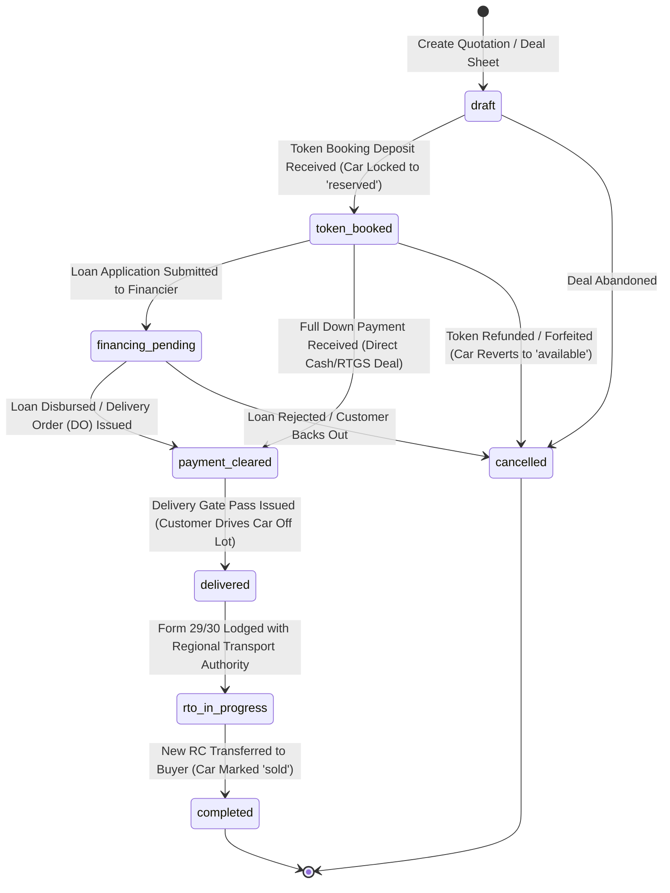
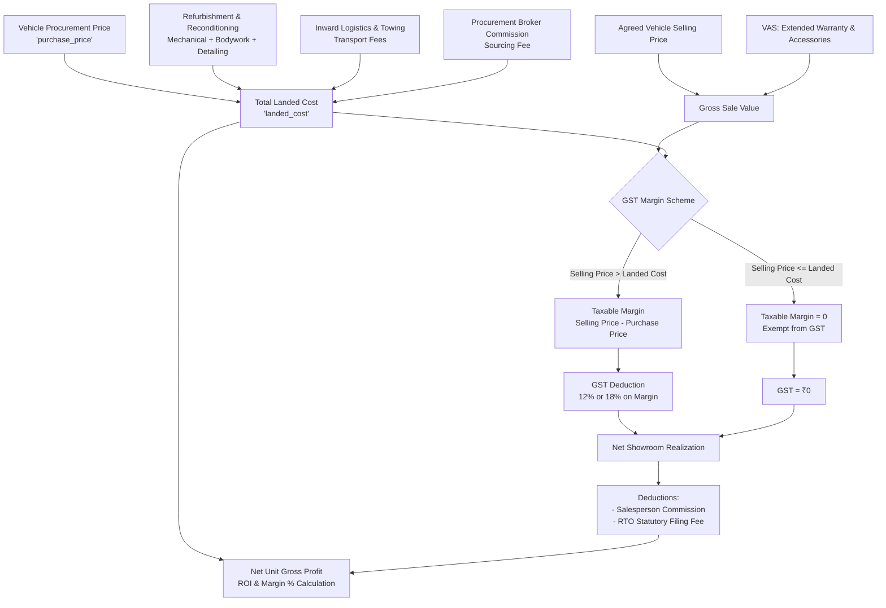

# Engineering Specification & Implementation Plan
# SALES DEALS, UNIT ECONOMICS & DEALERSHIP ACCOUNTING (`/dashboard/accounting`)
# ORGETISE — PRE-OWNED AUTOMOBILE DEALERSHIP SAAS

---

## 1. Executive Summary & Automotive Business Alignment

In the pre-owned automobile industry, dealership profitability is not determined merely by gross sales volume, but by **unit economics, capital turn velocity, and margin discipline**. Unlike new car franchises that operate on standardized OEM distributor invoices and manufacturer kickbacks, an independent pre-owned dealership operates as a specialized asset trader:

1. **Every Vehicle is a Unique Capital Investment**:
   - Each car is procured individually from an open market seller, corporate exchange, or trade-in.
   - Initial acquisition cost is only the starting point; vehicle reconditioning (mechanical overhaul, dent/paint rectification, detailing, new tyres, warranty inspection) directly capitalizes into the vehicle's **Total Landed Cost**.
2. **Multi-Source Deal Financing & Payment Cascades**:
   - Pre-owned car deals rarely settle with a single bank swipe. A standard ₹25,00,000 transaction routinely comprises:
     - A refundable or non-refundable **Token Booking Deposit** (e.g. ₹50,000).
     - A customer **Down Payment** via RTGS/NEFT or cheque (e.g. ₹4,50,000).
     - A third-party **Auto Loan Disbursement** from a financier like HDFC, ICICI, or Kotak Mahindra Prime (e.g. ₹18,00,000).
     - A **Trade-in / Exchange Vehicle Allowance** credited directly against the purchase price (e.g. ₹2,00,000).
3. **Statutory Taxation: The Indian GST Margin Scheme**:
   - In accordance with Indian tax laws (**Notification No. 8/2018-Central Tax (Rate)**), pre-owned motor vehicles are **exempt from GST on the total transaction value**.
   - Instead, GST is levied **strictly on the Margin** (the positive spread between the final selling price and the procurement purchase price). If a vehicle is liquidated at a loss or parity, zero GST is payable.
   - Tax rates on margin are differentiated by vehicle specifications:
     - **12% GST** (6% CGST + 6% SGST) for compact cars (<1200cc petrol / <1500cc diesel, length <4000mm).
     - **18% GST** (9% CGST + 9% SGST) for mid-size cars, luxury sedans, SUVs, and exotics.
4. **Legal Liability, Gate Pass & RTO Ownership Transfer**:
   - The moment a customer drives a vehicle off the lot represents maximum legal exposure for the dealership. Physical delivery requires a signed **Delivery Gate Pass**, odometer snapshot, and handover agreement.
   - Crucially, the deal cannot be closed in the accounting ledger until the vehicle's **Regional Transport Office (RTO) Transfer** (Form 29/30) is cleared and a new Registration Certificate (RC) smart card is issued to the buyer.

**Orgetise Sales & Accounting** is engineered specifically for these automotive realities:
- **Single-Showroom Architecture**: Tenant-isolated to the dealership's dedicated physical lot (`dealership_id`), in strict adherence to `AGENTS.md` Rule 5.7.
- **Strict Role-Based Access Control (RBAC)**: Only Showroom Owners, General Managers, and Dealership Accountants have visibility into acquisition procurement costs, reconditioning invoices, and net gross profit margins. Sales Executives see only asking prices, customer payment balances, and their earned commissions.
- **End-to-End Deal State Machine**: From initial token booking deposit through financing clearance, delivery gate pass checkout, and post-sale RTO transfer.

---

## 2. Operational Lifecycle & State Machines

### 2.1 The 7-Stage Sales Deal State Machine



#### Detailed Stage Definitions:

1. **`draft` (Deal Structuring & Quotation)**:
   - Sales executive prepares a pricing proposal for an `available` vehicle.
   - Outlines agreed vehicle selling price, trade-in exchange allowance (if applicable), and estimated insurance/RTO transfer fees.
2. **`token_booked` (Deposit Collected & Inventory Reserved)**:
   - Customer submits a token advance (e.g. ₹25,000–₹1,00,000).
   - System automatically switches vehicle status in `public.vehicles` from `available` $\to$ `reserved`, removing it from the public dealership website and preventing test-drive conflicts.
   - Generates a branded digital **Token Booking Receipt** with agreed delivery deadline and forfeiture terms.
3. **`financing_pending` (Auto Loan Processing)**:
   - Customer opt-in for dealership-assisted auto loan.
   - Records lender name (e.g. HDFC Bank, ICICI Bank, Kotak Prime), loan file reference, applied amount, and down payment shortfall.
   - Tracks Delivery Order (DO) issuance from the lender bank.
4. **`payment_cleared` (100% Financial Settlement)**:
   - All funds received and reconciled: Token + Down Payment + Loan Disbursement + Exchange Vehicle Allowance $=$ Net Deal Total.
   - Unlocks the **"Issue Delivery Gate Pass"** action button.
5. **`delivered` (Showroom Handover & Gate Pass Issued)**:
   - Vehicle officially checked out from the showroom floor.
   - Captures delivery odometer reading, fuel level, handover photo, signed Form 29/30 delivery acknowledgement, and handover date/time.
6. **`rto_in_progress` (RTO Title Transfer Tracking)**:
   - Dealership RTO agent submits transfer docket (Form 29, Form 30, NOC Form 35, original RC) to the transport authority.
   - Tracks application acknowledgement number and inspection date.
7. **`completed` (RC Transferred & Ledger Finalized)**:
   - Digital copy of updated Registration Certificate uploaded.
   - Vehicle officially transitions to `sold` in `public.vehicles`.
   - Sales executive commission is marked **Earned & Ready for Settlement**.
   - Deal closed in financial audit ledger.
8. **`cancelled` (Deal Abandoned / Refunded)**:
   - If deal falls through at Token stage: records refund amount, forfeiture penalty, and cancellation rationale.
   - Automatically releases the vehicle back to `available` on the showroom floor.

---

### 2.2 Vehicle Landed Cost & Unit Margin Cascade



---

## 3. Core Functional Modules & Operational Workflows

### 3.1 The Sales & Accounting Command Center (`/dashboard/accounting`)

The unified interface is organized into five operational tabs:
1. **Deals & Bookings Desk**: Active deals pipeline, token reservations, loan processing, and customer payment schedules.
2. **Inward Acquisitions & Landed Costing**: Vehicles procured, vendor bills, reconditioning job cards, and capitalized expenses.
3. **P&L & Margin Analytics**: Showroom unit economics, gross margins, capital turnaround days, and monthly profitability.
4. **GST & Invoicing Suite**: GST Margin Scheme tax invoices, token receipts, and statutory compliance register.
5. **Commissions & Settlements**: Sales executive performance payouts, lead referral fees, and broker settlement ledger.

---

### 3.2 Real-Time Showroom Financial KPIs

The top header renders four executive financial metrics computed dynamically from server-side verified records:

| KPI Metric | Calculation | Automotive Business Meaning |
| :--- | :--- | :--- |
| **Gross Revenue Realized** | $\sum \text{deal\_amount}$ for all deals in `delivered` or `completed` stage for the current billing cycle. | Total liquidity generated by inventory turnover. |
| **Net Gross Profit Margin** | $\sum (\text{Selling Price} - \text{Total Landed Cost} - \text{GST Margin}) / \text{Revenue} \times 100$. | Showroom pricing power and inventory buying efficiency. |
| **Capital Deployed in Stock** | $\sum (\text{purchase\_price} + \text{refurbishment\_cost})$ for all vehicles in `available` + `in_refurbishment` + `reserved`. | Working capital tied up on the showroom floor. |
| **Pending Receivables & DOs** | $\sum (\text{deal\_amount} - \text{payments\_received})$ for active deals (`token_booked`, `financing_pending`). | Immediate cash flow pipeline awaiting bank loan disbursals. |

---

### 3.3 Multi-Source Payment Reconciliation Desk

Each deal supports multiple payment tranches with unique verification attributes:

```
[ DEAL PAYMENT CASCADES ]
├── 1. Token Advance
│   ├── Amount: ₹50,000
│   ├── Mode: UPI / Card / Cash / Bank Transfer
│   ├── Status: Cleared
│   └── Artifact: Downloadable Token Receipt PDF
├── 2. Customer Down Payment
│   ├── Amount: ₹4,50,000
│   ├── Mode: RTGS / NEFT / Demand Draft
│   ├── Reference UTR: HDFC9284729183
│   └── Status: Cleared
├── 3. Auto Loan Disbursement (Financier)
│   ├── Lender: HDFC Bank Auto Loans
│   ├── Disbursed Amount: ₹18,00,000
│   ├── Loan Account No: AL-8392019
│   ├── Delivery Order (DO) Doc: Verified Attachment
│   └── Status: Disbursed
└── 4. Exchange Vehicle Allowance
    ├── Incoming Car: 2019 Hyundai Creta SX (DL-08-CC-4921)
    ├── Appraised Net Trade-in Value: ₹2,00,000
    ├── Stock Unit Generated: Linked to Vehicle Inventory (Status: Inward Draft)
    └── Status: Credited to Deal
```

---

### 3.4 Indian GST Margin Scheme Engine

Under Indian tax legislation (**Rule 32(5) of CGST Rules, 2017 & Notification No. 8/2018-Central Tax (Rate)**), the system calculates tax strictly on the profit spread:

```typescript
export function computeGstMarginScheme({
  sellingPrice,
  purchasePrice,
  fuelType,
  engineCapacityCc,
  lengthMm,
}: {
  sellingPrice: number;
  purchasePrice: number;
  fuelType: 'petrol' | 'diesel' | 'hybrid' | 'electric' | 'cng';
  engineCapacityCc: number;
  lengthMm: number;
}) {
  const margin = Math.max(0, sellingPrice - purchasePrice);

  if (margin === 0) {
    return {
      isExempt: true,
      taxableMargin: 0,
      gstRatePercent: 0,
      cgstAmount: 0,
      sgstAmount: 0,
      totalGstAmount: 0,
      netDealRealization: sellingPrice,
    };
  }

  // Determine statutory tax tier
  const isSub4MeterSmallCar =
    lengthMm < 4000 &&
    ((fuelType === 'petrol' && engineCapacityCc < 1200) ||
      (fuelType === 'diesel' && engineCapacityCc < 1500) ||
      fuelType === 'cng');

  const gstRatePercent = isSub4MeterSmallCar ? 12 : 18;
  
  // Margin is treated as inclusive of tax when issuing tax invoice to consumer
  // Taxable Base = Margin / (1 + Rate / 100)
  const taxableMargin = Math.round(margin / (1 + gstRatePercent / 100));
  const totalGstAmount = margin - taxableMargin;
  const cgstAmount = Math.round(totalGstAmount / 2);
  const sgstAmount = totalGstAmount - cgstAmount;

  return {
    isExempt: false,
    taxableMargin,
    gstRatePercent,
    cgstAmount,
    sgstAmount,
    totalGstAmount,
    netDealRealization: sellingPrice - totalGstAmount,
  };
}
```

---

### 3.5 Delivery Gate Pass & Handover Protocol

Prior to permitting any sold vehicle to roll out of the showroom premises, the system requires the issuance of a **Digital Delivery Gate Pass**:

1. **Security & Financial Clearance Check**:
   - Automated validator confirms `deal.balance_due === 0` (or bank DO attached and approved by Owner/Accountant).
2. **Physical Asset Verification**:
   - Exit Odometer Reading (km) verified.
   - Handover Checklist: 2 original keys, original service booklet, vehicle spare tyre, jack, tool kit, and valid pollution under control (PUC) certificate.
3. **Form 29 & Form 30 Acknowledgement**:
   - Buyer digital acknowledgement of physical receipt and legal responsibility from departure timestamp onward.
4. **Staff Sign-off**:
   - Handover conducted by assigned Sales Executive; gate clearance approved by Showroom Manager.

---

### 3.6 Post-Sale RTO Transfer Tracking

The legal sale of a pre-owned car is incomplete until the vehicle's title is transferred at the RTO:
- **Docket Status**: `not_started` $\to$ `docs_collected` $\to$ `submitted_to_rto` $\to$ `scrutiny_approved` $\to$ `rc_transferred`.
- **RTO Application Number**: Tracking number for the state Parivahan portal.
- **RTO Fees & Agent Charges**: Tracked against the deal expenses.
- **Digital RC Vault**: High-resolution scan of the newly issued Smart Card RC delivered to customer and stored in deal archives.

---

## 4. Database Schema Design (PostgreSQL / Supabase)

To be created in migration `supabase/migrations/20261105000006_create_sales_and_accounting.sql`:

```sql
-- ────────────────────────────────────────────────────────────────────
-- MIGRATION: SALES DEALS, PAYMENTS & UNIT ECONOMICS
-- ────────────────────────────────────────────────────────────────────

-- 1. Enums
CREATE TYPE deal_status AS ENUM (
  'draft',
  'token_booked',
  'financing_pending',
  'payment_cleared',
  'delivered',
  'rto_in_progress',
  'completed',
  'cancelled'
);

CREATE TYPE payment_method AS ENUM (
  'upi',
  'bank_transfer',
  'cheque',
  'cash',
  'card',
  'auto_loan',
  'exchange_trade_in'
);

CREATE TYPE payment_type AS ENUM (
  'token_deposit',
  'down_payment',
  'loan_disbursement',
  'exchange_adjustment',
  'final_settlement',
  'refund'
);

CREATE TYPE payment_status AS ENUM (
  'pending_clearance',
  'cleared',
  'bounced',
  'refunded'
);

CREATE TYPE rto_transfer_status AS ENUM (
  'pending_docs',
  'docs_collected',
  'submitted_to_rto',
  'scrutiny_approved',
  'rc_transferred',
  'disputed'
);

CREATE TYPE reconditioning_category AS ENUM (
  'mechanical_repair',
  'bodywork_paint',
  'detailing_ceramic',
  'tyre_replacement',
  'interior_restoration',
  'electrical_battery',
  'rto_paperwork_fines',
  'transportation_towing',
  'other'
);

-- 2. Vehicle Reconditioning / Expense Ledger (Landed Cost Tracking)
CREATE TABLE public.vehicle_expenses (
  id                   uuid PRIMARY KEY DEFAULT gen_random_uuid(),
  dealership_id        uuid NOT NULL REFERENCES public.dealerships(id) ON DELETE CASCADE,
  vehicle_id           uuid NOT NULL REFERENCES public.vehicles(id) ON DELETE CASCADE,
  
  category             reconditioning_category NOT NULL DEFAULT 'mechanical_repair',
  description          text NOT NULL,
  vendor_name          text,
  invoice_number       text,
  invoice_date         date DEFAULT CURRENT_DATE,
  
  amount               bigint NOT NULL CHECK (amount >= 0), -- Stored in minor units (INR ₹)
  paid_by_dealership   boolean NOT NULL DEFAULT true,
  receipt_url          text,
  
  created_by           uuid REFERENCES public.profiles(id) ON DELETE SET NULL,
  created_at           timestamptz NOT NULL DEFAULT now(),
  updated_at           timestamptz NOT NULL DEFAULT now()
);

-- 3. Sales Deals Table
CREATE TABLE public.sales_deals (
  id                     uuid PRIMARY KEY DEFAULT gen_random_uuid(),
  dealership_id          uuid NOT NULL REFERENCES public.dealerships(id) ON DELETE CASCADE,
  deal_number            text NOT NULL UNIQUE, -- e.g. "DL-2026-0042"
  
  -- Relational Links
  vehicle_id             uuid NOT NULL REFERENCES public.vehicles(id) ON DELETE RESTRICT,
  lead_id                uuid REFERENCES public.leads(id) ON DELETE SET NULL,
  sales_rep_id           uuid REFERENCES public.profiles(id) ON DELETE SET NULL,
  
  -- Buyer Dossier
  customer_name          text NOT NULL,
  customer_phone         text NOT NULL,
  customer_email         text,
  customer_address       text,
  customer_pan           text,
  customer_aadhaar       text,
  
  -- Deal Economics (All currency in minor units: INR ₹)
  agreed_selling_price   bigint NOT NULL CHECK (agreed_selling_price > 0),
  rto_transfer_charges   bigint NOT NULL DEFAULT 0,
  insurance_charges      bigint NOT NULL DEFAULT 0,
  extended_warranty_fee  bigint NOT NULL DEFAULT 0,
  accessories_charges    bigint NOT NULL DEFAULT 0,
  discount_amount        bigint NOT NULL DEFAULT 0,
  total_deal_amount      bigint NOT NULL, -- Computed: (agreed + rto + ins + warr + acc - disc)
  
  -- Token & Booking Parameters
  token_amount           bigint NOT NULL DEFAULT 0,
  token_paid_at          timestamptz,
  token_receipt_number   text,
  is_token_refundable    boolean NOT NULL DEFAULT false,
  
  -- Auto Loan / Financing Details
  is_financed            boolean NOT NULL DEFAULT false,
  financier_name         text,
  loan_application_ref   text,
  loan_sanctioned_amount bigint DEFAULT 0,
  loan_disbursed_amount  bigint DEFAULT 0,
  delivery_order_number  text,
  delivery_order_url     text,
  
  -- Trade-in / Exchange Vehicle
  has_exchange           boolean NOT NULL DEFAULT false,
  exchange_vehicle_id    uuid REFERENCES public.vehicles(id) ON DELETE SET NULL,
  exchange_allowance     bigint DEFAULT 0,
  
  -- Statutory GST Margin Scheme Breakdown
  vehicle_purchase_cost  bigint NOT NULL, -- Snapshot of purchase_price at deal creation
  vehicle_landed_cost    bigint NOT NULL, -- Snapshot of (purchase + sum of vehicle_expenses)
  taxable_margin         bigint NOT NULL DEFAULT 0,
  gst_rate_percent       smallint NOT NULL DEFAULT 18,
  cgst_amount            bigint NOT NULL DEFAULT 0,
  sgst_amount            bigint NOT NULL DEFAULT 0,
  total_gst_on_margin    bigint NOT NULL DEFAULT 0,
  
  -- Final Financial Performance (Protected RBAC)
  net_gross_profit       bigint NOT NULL DEFAULT 0, -- (agreed_price - landed_cost - gst_margin)
  sales_commission_amount bigint NOT NULL DEFAULT 0,
  
  -- Status & Milestones
  status                 deal_status NOT NULL DEFAULT 'draft',
  rto_status             rto_transfer_status NOT NULL DEFAULT 'pending_docs',
  rto_application_no     text,
  rto_completion_date    date,
  new_rc_smartcard_url   text,
  
  -- Gate Pass & Delivery Handover
  gate_pass_number       text UNIQUE,
  delivered_at           timestamptz,
  delivery_odometer_km   integer,
  delivery_fuel_level    text,
  handover_photo_url     text,
  delivery_notes         text,
  
  -- Cancellation & Notes
  cancellation_reason    text,
  internal_notes         text,
  
  created_at             timestamptz NOT NULL DEFAULT now(),
  updated_at             timestamptz NOT NULL DEFAULT now()
);

-- 4. Deal Payments Ledger (Tranches & Receipts)
CREATE TABLE public.deal_payments (
  id                   uuid PRIMARY KEY DEFAULT gen_random_uuid(),
  dealership_id        uuid NOT NULL REFERENCES public.dealerships(id) ON DELETE CASCADE,
  deal_id              uuid NOT NULL REFERENCES public.sales_deals(id) ON DELETE CASCADE,
  
  payment_number       text NOT NULL, -- e.g. "PAY-2026-0182"
  payment_type         payment_type NOT NULL DEFAULT 'down_payment',
  payment_method       payment_method NOT NULL DEFAULT 'bank_transfer',
  payment_status       payment_status NOT NULL DEFAULT 'cleared',
  
  amount               bigint NOT NULL CHECK (amount > 0),
  transaction_ref      text, -- UTR / Cheque No / UPI Transaction ID
  cheque_bank_name     text,
  cheque_date          date,
  
  cleared_at           timestamptz DEFAULT now(),
  received_by          uuid REFERENCES public.profiles(id) ON DELETE SET NULL,
  receipt_pdf_url      text,
  notes                text,
  
  created_at           timestamptz NOT NULL DEFAULT now()
);

-- 5. Sales Commission Ledger
CREATE TABLE public.deal_commissions (
  id                   uuid PRIMARY KEY DEFAULT gen_random_uuid(),
  dealership_id        uuid NOT NULL REFERENCES public.dealerships(id) ON DELETE CASCADE,
  deal_id              uuid NOT NULL REFERENCES public.sales_deals(id) ON DELETE CASCADE,
  sales_rep_id         uuid NOT NULL REFERENCES public.profiles(id) ON DELETE CASCADE,
  
  commission_amount    bigint NOT NULL CHECK (commission_amount >= 0),
  calculation_basis    text NOT NULL DEFAULT 'fixed', -- 'fixed' or 'percent_of_margin'
  percentage_rate      numeric(5,2),
  
  is_approved          boolean NOT NULL DEFAULT false,
  approved_by          uuid REFERENCES public.profiles(id) ON DELETE SET NULL,
  approved_at          timestamptz,
  
  is_paid              boolean NOT NULL DEFAULT false,
  paid_at              timestamptz,
  payment_ref          text,
  
  created_at           timestamptz NOT NULL DEFAULT now()
);

-- Performance Indexes
CREATE INDEX vehicle_expenses_dealership_idx ON public.vehicle_expenses(dealership_id);
CREATE INDEX vehicle_expenses_vehicle_idx ON public.vehicle_expenses(vehicle_id);

CREATE INDEX sales_deals_dealership_idx ON public.sales_deals(dealership_id);
CREATE INDEX sales_deals_vehicle_idx ON public.sales_deals(vehicle_id);
CREATE INDEX sales_deals_lead_idx ON public.sales_deals(lead_id);
CREATE INDEX sales_deals_sales_rep_idx ON public.sales_deals(dealership_id, sales_rep_id);
CREATE INDEX sales_deals_status_idx ON public.sales_deals(dealership_id, status);
CREATE INDEX sales_deals_rto_status_idx ON public.sales_deals(dealership_id, rto_status);
CREATE INDEX sales_deals_created_at_idx ON public.sales_deals(dealership_id, created_at DESC);

CREATE INDEX deal_payments_dealership_idx ON public.deal_payments(dealership_id);
CREATE INDEX deal_payments_deal_idx ON public.deal_payments(deal_id);
CREATE INDEX deal_payments_status_idx ON public.deal_payments(dealership_id, payment_status);

CREATE INDEX deal_commissions_dealership_idx ON public.deal_commissions(dealership_id);
CREATE INDEX deal_commissions_rep_idx ON public.deal_commissions(sales_rep_id);

-- ────────────────────────────────────────────────────────────────────
-- ROW LEVEL SECURITY (RLS) POLICIES
-- ────────────────────────────────────────────────────────────────────
ALTER TABLE public.vehicle_expenses ENABLE ROW LEVEL SECURITY;
ALTER TABLE public.sales_deals ENABLE ROW LEVEL SECURITY;
ALTER TABLE public.deal_payments ENABLE ROW LEVEL SECURITY;
ALTER TABLE public.deal_commissions ENABLE ROW LEVEL SECURITY;

-- VEHICLE EXPENSES POLICIES (Protected Landed Costs)
CREATE POLICY "Owners and Accountants can view vehicle expenses"
  ON public.vehicle_expenses FOR SELECT
  USING (
    dealership_id = public.get_my_dealership_id()
    AND (public.is_dealership_owner() = true OR public.get_my_role() IN ('admin', 'accountant'))
  );

CREATE POLICY "Owners and Accountants can manage vehicle expenses"
  ON public.vehicle_expenses FOR ALL
  USING (
    dealership_id = public.get_my_dealership_id()
    AND (public.is_dealership_owner() = true OR public.get_my_role() IN ('admin', 'accountant'))
  );

-- SALES DEALS POLICIES
CREATE POLICY "Members can view deals of their showroom"
  ON public.sales_deals FOR SELECT
  USING (
    dealership_id = public.get_my_dealership_id()
    AND (
      public.is_dealership_owner() = true
      OR public.get_my_role() IN ('admin', 'accountant', 'sales_manager')
      OR sales_rep_id = auth.uid() -- Sales reps see their own deals
    )
  );

CREATE POLICY "Authorized staff can create deals"
  ON public.sales_deals FOR INSERT
  WITH CHECK (dealership_id = public.get_my_dealership_id());

CREATE POLICY "Authorized staff can update deals"
  ON public.sales_deals FOR UPDATE
  USING (dealership_id = public.get_my_dealership_id());

CREATE POLICY "Only Owners can delete deals"
  ON public.sales_deals FOR DELETE
  USING (
    dealership_id = public.get_my_dealership_id()
    AND public.is_dealership_owner() = true
  );

-- DEAL PAYMENTS POLICIES
CREATE POLICY "Members can view payments"
  ON public.deal_payments FOR SELECT
  USING (dealership_id = public.get_my_dealership_id());

CREATE POLICY "Authorized staff can record payments"
  ON public.deal_payments FOR INSERT
  WITH CHECK (dealership_id = public.get_my_dealership_id());

CREATE POLICY "Only Accountants and Owners can edit payments"
  ON public.deal_payments FOR UPDATE
  USING (
    dealership_id = public.get_my_dealership_id()
    AND (public.is_dealership_owner() = true OR public.get_my_role() IN ('admin', 'accountant'))
  );

-- COMMISSIONS POLICIES
CREATE POLICY "Sales reps can view their own commissions, owners view all"
  ON public.deal_commissions FOR SELECT
  USING (
    dealership_id = public.get_my_dealership_id()
    AND (
      public.is_dealership_owner() = true
      OR public.get_my_role() IN ('admin', 'accountant')
      OR sales_rep_id = auth.uid()
    )
  );

CREATE POLICY "Owners and Accountants manage commissions"
  ON public.deal_commissions FOR ALL
  USING (
    dealership_id = public.get_my_dealership_id()
    AND (public.is_dealership_owner() = true OR public.get_my_role() IN ('admin', 'accountant'))
  );
```

---

## 5. TypeScript Contracts & Zod Validation Schemas

### 5.1 Domain Models (`packages/supabase/src/types.ts`)

```typescript
export type DealStatus =
  | 'draft'
  | 'token_booked'
  | 'financing_pending'
  | 'payment_cleared'
  | 'delivered'
  | 'rto_in_progress'
  | 'completed'
  | 'cancelled';

export type PaymentMethod =
  | 'upi'
  | 'bank_transfer'
  | 'cheque'
  | 'cash'
  | 'card'
  | 'auto_loan'
  | 'exchange_trade_in';

export type PaymentType =
  | 'token_deposit'
  | 'down_payment'
  | 'loan_disbursement'
  | 'exchange_adjustment'
  | 'final_settlement'
  | 'refund';

export type PaymentStatus =
  | 'pending_clearance'
  | 'cleared'
  | 'bounced'
  | 'refunded';

export type RtoTransferStatus =
  | 'pending_docs'
  | 'docs_collected'
  | 'submitted_to_rto'
  | 'scrutiny_approved'
  | 'rc_transferred'
  | 'disputed';

export type ReconditioningCategory =
  | 'mechanical_repair'
  | 'bodywork_paint'
  | 'detailing_ceramic'
  | 'tyre_replacement'
  | 'interior_restoration'
  | 'electrical_battery'
  | 'rto_paperwork_fines'
  | 'transportation_towing'
  | 'other';
```

---

### 5.2 Zod Schemas (`apps/web/lib/validations/accounting.ts`)

```typescript
import { z } from 'zod';

export const createSalesDealSchema = z.object({
  vehicle_id: z.string().uuid("Please select a valid certified vehicle"),
  lead_id: z.string().uuid().optional().nullable(),
  sales_rep_id: z.string().uuid().optional().nullable(),
  
  // Customer details
  customer_name: z.string().min(2, "Customer full name is required"),
  customer_phone: z.string().min(10, "Valid 10-digit mobile number required"),
  customer_email: z.string().email().optional().or(z.literal("")),
  customer_address: z.string().optional().or(z.literal("")),
  customer_pan: z.string().regex(/^[A-Z]{5}[0-9]{4}[A-Z]{1}$/, "Valid Indian PAN required (e.g. ABCDE1234F)").optional().or(z.literal("")),
  customer_aadhaar: z.string().regex(/^[0-9]{12}$/, "Valid 12-digit Aadhaar number required").optional().or(z.literal("")),
  
  // Commercials (INR)
  agreed_selling_price: z.coerce.number().min(10000, "Selling price must be at least ₹10,000"),
  rto_transfer_charges: z.coerce.number().min(0).default(0),
  insurance_charges: z.coerce.number().min(0).default(0),
  extended_warranty_fee: z.coerce.number().min(0).default(0),
  accessories_charges: z.coerce.number().min(0).default(0),
  discount_amount: z.coerce.number().min(0).default(0),
  
  // Token
  token_amount: z.coerce.number().min(0).default(0),
  is_token_refundable: z.boolean().default(false),
  
  // Financing
  is_financed: z.boolean().default(false),
  financier_name: z.string().optional().or(z.literal("")),
  loan_sanctioned_amount: z.coerce.number().min(0).default(0),
  
  // Trade-in
  has_exchange: z.boolean().default(false),
  exchange_vehicle_id: z.string().uuid().optional().nullable(),
  exchange_allowance: z.coerce.number().min(0).default(0),
  
  sales_commission_amount: z.coerce.number().min(0).default(0),
  internal_notes: z.string().optional(),
});

export const recordPaymentSchema = z.object({
  deal_id: z.string().uuid(),
  amount: z.coerce.number().min(100, "Minimum payment amount is ₹100"),
  payment_type: z.enum([
    'token_deposit',
    'down_payment',
    'loan_disbursement',
    'exchange_adjustment',
    'final_settlement',
    'refund',
  ]),
  payment_method: z.enum([
    'upi',
    'bank_transfer',
    'cheque',
    'cash',
    'card',
    'auto_loan',
    'exchange_trade_in',
  ]),
  transaction_ref: z.string().min(2, "Transaction reference or UTR is required"),
  cheque_bank_name: z.string().optional().or(z.literal("")),
  cheque_date: z.string().optional().or(z.literal("")),
  notes: z.string().optional(),
});

export const addVehicleExpenseSchema = z.object({
  vehicle_id: z.string().uuid(),
  category: z.enum([
    'mechanical_repair',
    'bodywork_paint',
    'detailing_ceramic',
    'tyre_replacement',
    'interior_restoration',
    'electrical_battery',
    'rto_paperwork_fines',
    'transportation_towing',
    'other',
  ]),
  description: z.string().min(3, "Detailed expense description required"),
  amount: z.coerce.number().min(1, "Expense amount must be positive"),
  vendor_name: z.string().optional(),
  invoice_number: z.string().optional(),
  invoice_date: z.string().optional(),
});

export const issueDeliveryGatePassSchema = z.object({
  deal_id: z.string().uuid(),
  delivery_odometer_km: z.coerce.number().min(0, "Current odometer reading required"),
  delivery_fuel_level: z.string().min(1, "Fuel level specification required"),
  handover_notes: z.string().optional(),
});

export const updateRtoStatusSchema = z.object({
  deal_id: z.string().uuid(),
  rto_status: z.enum([
    'pending_docs',
    'docs_collected',
    'submitted_to_rto',
    'scrutiny_approved',
    'rc_transferred',
    'disputed',
  ]),
  rto_application_no: z.string().optional(),
  rto_completion_date: z.string().optional(),
  new_rc_smartcard_url: z.string().url().optional().or(z.literal("")),
});
```

---

## 6. Server Actions & Business Logic Layer (`apps/web/app/dashboard/accounting/actions.ts`)

### Key Server Actions:

1. `getAccountingOverviewAction(filters)`:
   - Uses `getAuthenticatedContext()` from `@/lib/auth`.
   - Computes live header KPIs:
     - Realized Revenue, Net Gross Profit (RBAC protected), Total Capital Deployed, Pending Receivables.
   - Fetches paginated deals joined with:
     - `vehicles(id, brand, model, variant, registration_number, kilometers, purchase_price, asking_price)`
     - `deal_payments(id, amount, payment_method, payment_status)`
     - `profiles:sales_rep_id(id, full_name)`
   - Computes dynamic balance due: `balance_due = total_deal_amount - sum(cleared_payments)`.
2. `createSalesDealAction(formData)`:
   - Validates input via `createSalesDealSchema`.
   - Checks vehicle availability: Verifies that `vehicles.status === 'available'`.
   - Fetches vehicle's current `purchase_price` and sums all `vehicle_expenses` to snapshot `vehicle_purchase_cost` and `vehicle_landed_cost`.
   - Calculates GST Margin Scheme:
     - Determines taxable spread: $\text{Margin} = \max(0, \text{Agreed Price} - \text{Purchase Price})$.
     - Applies statutory CGST + SGST.
   - Computes Projected Net Gross Profit: $\text{Net Profit} = \text{Agreed Price} - \text{Landed Cost} - \text{Total GST} - \text{Commission}$.
   - Executes database transaction:
     - Generates incremental deal sequence: `DL-2026-XXXX`.
     - Inserts record into `public.sales_deals`.
     - If `token_amount > 0`: Inserts corresponding record into `public.deal_payments` and marks deal status as `token_booked`.
     - Automatically updates `public.vehicles.status` to `reserved`.
     - If linked to `lead_id`: Automatically advances `leads.status` to `booked` and creates an audit log in `lead_activities`.
   - Revalidates paths: `/dashboard/accounting`, `/dashboard/inventory`, `/dashboard/leads`.
3. `recordPaymentAction(formData)`:
   - Validates input via `recordPaymentSchema`.
   - Inserts record into `public.deal_payments`.
   - Re-evaluates total payments received against `total_deal_amount`:
     - If fully settled $\to$ transitions `sales_deals.status` to `payment_cleared`.
   - Revalidates `/dashboard/accounting`.
4. `addVehicleExpenseAction(formData)`:
   - Restricted to `owner`, `admin`, and `accountant` roles.
   - Inserts record into `public.vehicle_expenses`.
   - Updates `public.vehicles.refurbishment_cost` with the running total.
   - Revalidates `/dashboard/accounting`, `/dashboard/inventory`.
5. `issueDeliveryGatePassAction(formData)`:
   - Verifies user authorization and ensures deal is in `payment_cleared` status.
   - Generates sequential gate pass identifier: `GP-2026-XXXX`.
   - Updates deal status to `delivered`, stamps `delivered_at = now()`.
   - Creates delivery activity log.
   - Revalidates `/dashboard/accounting`.
6. `updateRtoStatusAction(formData)`:
   - Updates `sales_deals.rto_status`, application tracking number, or uploaded smart card URL.
   - If `rto_status === 'rc_transferred'`:
     - Sets deal status to `completed`.
     - Updates `vehicles.status` to `sold`.
     - Sets linked commission to `is_approved = true`.
   - Revalidates `/dashboard/accounting`.

---

## 7. UI/UX Architecture & Component Structure

Adheres strictly to Orgetise's luxury design system: warm cream surfaces (`#FDFBF7`), deep obsidian accents (`#0A0A0A`), crisp border treatment (`border-neutral-200/80`), subtle badges, and zero UI clutter.

```
apps/web/
├── app/
│   └── dashboard/
│       └── accounting/
│           ├── page.tsx                     # Server Component (auth & initial fetch)
│           ├── actions.ts                   # Fast server actions with getAuthenticatedContext
│           └── loading.tsx                  # Luxury skeleton loader
├── components/
│   └── accounting/
│       ├── accounting-shell.tsx             # Tab orchestrator (Deals, Landed Costs, P&L, Invoices)
│       ├── accounting-header.tsx            # KPI metrics (Revenue, Margin %, Deployed Capital, Receivables)
│       ├── accounting-toolbar.tsx           # Search, Status filter, Date range, Export CSV
│       │
│       ├── deals/
│       │   ├── deals-kanban.tsx             # 7-stage pipeline cards
│       │   ├── deals-table.tsx              # Density-optimized data table with balance meters
│       │   ├── deal-card.tsx                # Deal summary card (car thumbnail, buyer, amounts, status)
│       │   ├── deal-status-badge.tsx        # Standardized deal & RTO badge indicators
│       │   └── deal-detail-drawer.tsx       # Comprehensive deal dossier & ledger timeline
│       │
│       ├── acquisitions/
│       │   ├── landed-cost-table.tsx        # Inventory list with procurement vs landed cost breakdown
│       │   ├── expense-ledger-modal.tsx     # Add repair/detailing job card modal
│       │   └── unit-economics-modal.tsx     # Deep-dive vehicle P&L analysis
│       │
│       ├── documents/
│       │   ├── token-receipt-template.tsx   # Printable / PDF token booking receipt
│       │   ├── margin-invoice-template.tsx  # Statutory GST Margin Scheme Tax Invoice
│       │   └── delivery-gate-pass-modal.tsx # Gate pass inspection & rollout slip
│       │
│       └── modals/
│           ├── create-deal-modal.tsx        # New deal sheet creation wizard
│           ├── record-payment-modal.tsx     # Tranche payment collection dialog
│           └── rto-update-modal.tsx         # RTO transfer status updater
```

---

## 8. Printable Document Templates

### 8.1 GST Margin Scheme Tax Invoice Specification
Every generated invoice includes:
- **Dealership Identity**: Registered Showroom Name, Dedicated Address, GSTIN, PAN, and State Code.
- **Customer Dossier**: Name, Phone, Address, State, and PAN/Aadhaar.
- **Vehicle Certification**: Brand, Model, Variant, Registration Number, Chassis/VIN, Engine Number, Fuel Type, and Odometer Reading.
- **Statutory Margin Declaration**:
  > *"Tax Invoice issued in accordance with Rule 32(5) of the CGST Rules, 2017 and Notification No. 8/2018-Central Tax (Rate). GST is charged on the taxable margin of pre-owned motor vehicle."*
- **Itemized Ledger**:
  - Vehicle Margin Base Value
  - CGST (e.g. 9%) + SGST (e.g. 9%)
  - RTO Ownership Transfer Fee (Exempt)
  - Comprehensive Insurance Fee (Separate/Exempt)
  - Net Realized Invoiced Total

### 8.2 Delivery Gate Pass Specification
- Showroom Gate Pass Number & Timestamp
- Security Clearance Seal: `"100% Payment Cleared / Bank DO on File"`
- Vehicle Reg Number, Starting Odometer, Fuel Level
- Customer Signature & Sales Manager Authorizing Signature

---

## 9. Phased Implementation Roadmap

### Phase 1: Database Migration & Multi-Tenant Schema Setup
- Create `supabase/migrations/20261105000006_create_sales_and_accounting.sql`.
- Apply migration and update `packages/supabase/src/types.ts`.
- Seed 5 realistic luxury pre-owned transactions (e.g., Porsche 911 GT3 `delivered`, BMW M4 `token_booked`, Defender `financing_pending`, Mercedes G63 `completed`).

### Phase 2: Server Actions & Business Engine
- Create `apps/web/app/dashboard/accounting/actions.ts`.
- Implement `getAccountingOverviewAction` leveraging `getAuthenticatedContext()`.
- Implement `createSalesDealAction` with automatic vehicle status locking (`available` $\to$ `reserved`) and GST margin calculation.
- Implement `recordPaymentAction`, `addVehicleExpenseAction`, `issueDeliveryGatePassAction`, and `updateRtoStatusAction`.

### Phase 3: Core UI (Header, Toolbar, Deals Table & Kanban)
- Implement `accounting-header.tsx` with dynamic KPI cards.
- Implement `accounting-toolbar.tsx` with search, status filters, and view toggles.
- Build `deals-table.tsx` with financial balance indicators and action menus.
- Build `deals-kanban.tsx` for visual drag-and-drop deal tracking.

### Phase 4: Landed Costing & Unit Economics Drawer
- Build `landed-cost-table.tsx` showing purchase price + reconditioning expenses.
- Build `expense-ledger-modal.tsx` to add mechanical, painting, and detailing bills.
- Build `deal-detail-drawer.tsx` showing the complete chronological deal story (Token $\to$ Payments $\to$ Gate Pass $\to$ RTO).

### Phase 5: Digital Documents & Handover Protocol
- Build `margin-invoice-template.tsx` with clean print styling (`@media print`).
- Build `delivery-gate-pass-modal.tsx` with pre-departure checklist.
- Build `token-receipt-template.tsx` with luxury branding.

### Phase 6: Verification & Quality Assurance Gates
- Execute `pnpm --filter web check-types` (0 errors).
- Execute `pnpm --filter web build` (successful compilation of `/dashboard/accounting`).
- Verify multi-tenant RLS isolation: Ensure sales representatives cannot access acquisition purchase costs or net profit margins.

