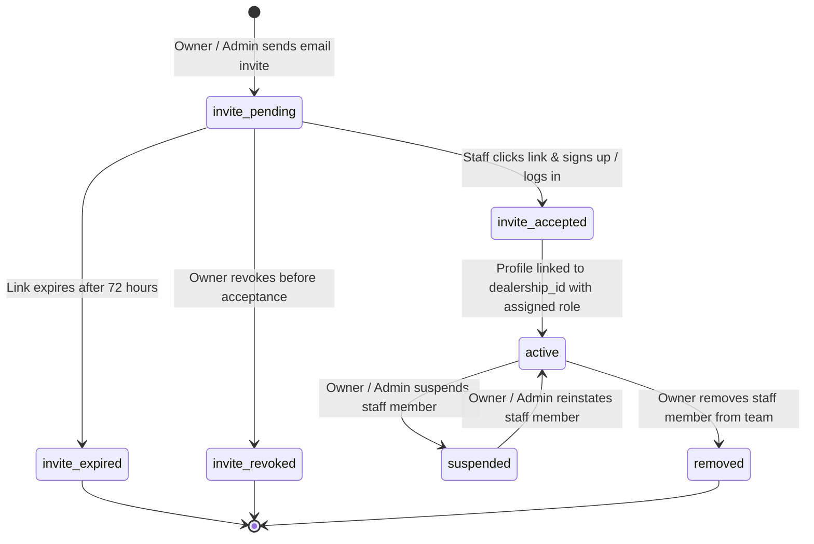
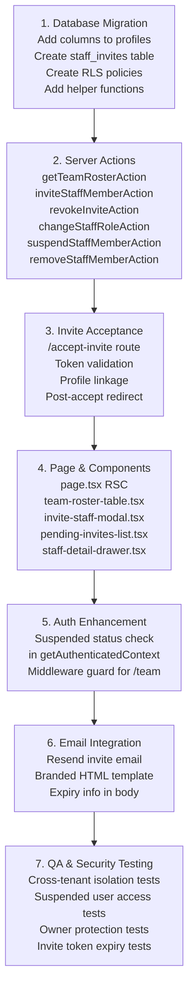

# Engineering Specification & Implementation Plan
# STAFF & ROLES — TEAM ACCESS MANAGEMENT (`/dashboard/team`)
# ORGETISE — PRE-OWNED AUTOMOBILE DEALERSHIP SAAS

---

## 1. Executive Summary & Business Context

A pre-owned automobile dealership is not a solo operation. Even a mid-sized showroom with 20–50 cars on the floor requires a coordinated team where every member has a precisely scoped set of responsibilities, trust levels, and information access rights:

- A **Showroom Principal / Owner** bears full legal liability, financial risk, and business ownership. They need unrestricted visibility into procurement costs, gross margins, payroll, and audit trails.
- A **Sales Manager** orchestrates the daily floor: assigns leads, monitors pipeline velocity, coordinates test drives, and reviews deal closings — but should not view payroll data or modify subscription billing.
- A **Sales Executive** executes the customer-facing work: follows up on leads, books test drives, prepares deal quotations, and collects token bookings. Their information access should be tightly scoped to their own assigned leads and deals, not the internal purchase costs of vehicles.
- An **Accountant** reconciles payments, records expenses, generates GST margin statements, and handles RTO payment tracking — but has no business managing sales pipeline operations or lead assignments.
- A **Service / Inventory Manager** maintains the floor: adds newly procured vehicles, updates refurbishment cost logs, publishes listings, and manages vehicle media — without needing access to customer financial data.
- A **Viewer** (e.g., a dealer group investor or silent partner) may need read-only visibility into select business metrics without any write access.

**Orgetise Staff & Roles** is the operational backbone that enforces these access boundaries:

- **Role-Based Access Control (RBAC)**: 7 predefined system roles, each with a carefully scoped permission set covering every module in the platform.
- **Invite-Based Onboarding**: Owners dispatch secure invite links (email-based or shareable) to bring new staff members onto the platform without needing to share passwords or manage raw credentials.
- **Single-Showroom Architecture**: Each dealership (`dealership_id`) manages its own isolated team. A staff member at Apex Motors has zero access to data from Premium Auto Gallery, even if they sign into the same Orgetise platform.
- **Self-Service Team Governance**: Owners can suspend, reactivate, role-change, and remove staff with immediate effect — revocations take effect the next API call without requiring a deployment or manual intervention.

---

## 2. The Orgetise Role Hierarchy

The following 7 roles form the complete role taxonomy for a single-showroom dealership:

```
┌────────────────────────────────────────────────────────────────────┐
│                       DEALERSHIP TEAM HIERARCHY                    │
├──────────────────────────┬─────────────────────────────────────────┤
│ ROLE                     │ TYPICAL REAL-WORLD JOB TITLE            │
├──────────────────────────┼─────────────────────────────────────────┤
│ owner                    │ Proprietor / Showroom Principal          │
│ admin                    │ General Manager / Operations Head        │
│ sales_manager            │ Sales Manager / Floor Manager            │
│ sales_executive          │ Sales Advisor / Sales Representative     │
│ inventory_manager        │ Stock Manager / Fleet Procurement Head   │
│ accountant               │ Accounts Manager / Finance Controller    │
│ viewer                   │ Silent Partner / Dealer Group Investor   │
└──────────────────────────┴─────────────────────────────────────────┘
```

---

## 3. Role Permission Matrix

The following matrix defines the exact access each role has per module. This forms the authority for every RBAC guard implemented in backend actions and UI conditionals.

### Legend
- `✅ Full` — Full read and write access
- `📖 Read` — Read-only access
- `✏️ Own` — Read/write limited to their own records (assigned leads, their own deals)
- `🔒 None` — No access (backend guards block; UI element hidden)
- `⚡ Limited` — Partial access (specific sub-features only, as annotated)

| Module / Feature                        | `owner` | `admin` | `sales_manager` | `sales_executive` | `inventory_manager` | `accountant` | `viewer` |
|:----------------------------------------|:-------:|:-------:|:---------------:|:-----------------:|:-------------------:|:------------:|:--------:|
| **DASHBOARD OVERVIEW**                  |         |         |                 |                   |                     |              |          |
| View KPI metrics (revenue, deals)       | ✅ Full  | ✅ Full  | 📖 Read         | 🔒 None           | 🔒 None             | 📖 Read      | 📖 Read  |
| View vehicle turnover analytics         | ✅ Full  | ✅ Full  | 📖 Read         | 🔒 None           | 📖 Read             | 📖 Read      | 📖 Read  |
| View team performance metrics           | ✅ Full  | ✅ Full  | 📖 Read         | ✏️ Own            | 🔒 None             | 🔒 None      | 🔒 None  |
| **FLEET INVENTORY**                     |         |         |                 |                   |                     |              |          |
| View vehicle listings                   | ✅ Full  | ✅ Full  | ✅ Full         | 📖 Read           | ✅ Full             | 📖 Read      | 📖 Read  |
| Add / edit vehicle details              | ✅ Full  | ✅ Full  | ⚡ Limited      | 🔒 None           | ✅ Full             | 🔒 None      | 🔒 None  |
| View purchase price & landed cost       | ✅ Full  | ✅ Full  | 🔒 None         | 🔒 None           | ✅ Full             | ✅ Full       | 🔒 None  |
| Upload / manage vehicle media           | ✅ Full  | ✅ Full  | 🔒 None         | 🔒 None           | ✅ Full             | 🔒 None      | 🔒 None  |
| Change vehicle status (publish/archive) | ✅ Full  | ✅ Full  | 🔒 None         | 🔒 None           | ✅ Full             | 🔒 None      | 🔒 None  |
| Delete a vehicle record                 | ✅ Full  | ✅ Full  | 🔒 None         | 🔒 None           | 🔒 None             | 🔒 None      | 🔒 None  |
| **LEADS & INQUIRIES CRM**               |         |         |                 |                   |                     |              |          |
| View all leads pipeline                 | ✅ Full  | ✅ Full  | ✅ Full         | ✏️ Own            | 🔒 None             | 🔒 None      | 🔒 None  |
| Create new lead / walk-in inquiry       | ✅ Full  | ✅ Full  | ✅ Full         | ✅ Full            | 🔒 None             | 🔒 None      | 🔒 None  |
| Assign / reassign lead to sales exec    | ✅ Full  | ✅ Full  | ✅ Full         | 🔒 None           | 🔒 None             | 🔒 None      | 🔒 None  |
| Update lead status & add activity notes | ✅ Full  | ✅ Full  | ✅ Full         | ✏️ Own            | 🔒 None             | 🔒 None      | 🔒 None  |
| Delete a lead record                    | ✅ Full  | ✅ Full  | 🔒 None         | 🔒 None           | 🔒 None             | 🔒 None      | 🔒 None  |
| **TEST DRIVES**                         |         |         |                 |                   |                     |              |          |
| View test drive schedule                | ✅ Full  | ✅ Full  | ✅ Full         | ✅ Full            | 🔒 None             | 🔒 None      | 🔒 None  |
| Schedule a new appointment              | ✅ Full  | ✅ Full  | ✅ Full         | ✅ Full            | 🔒 None             | 🔒 None      | 🔒 None  |
| Issue gate pass / checkout vehicle      | ✅ Full  | ✅ Full  | ✅ Full         | ✅ Full            | 🔒 None             | 🔒 None      | 🔒 None  |
| Complete / return check-in              | ✅ Full  | ✅ Full  | ✅ Full         | ✅ Full            | 🔒 None             | 🔒 None      | 🔒 None  |
| Cancel / no-show a test drive           | ✅ Full  | ✅ Full  | ✅ Full         | ✏️ Own            | 🔒 None             | 🔒 None      | 🔒 None  |
| **SALES & ACCOUNTING**                  |         |         |                 |                   |                     |              |          |
| View deals pipeline & ledger            | ✅ Full  | ✅ Full  | 📖 Read         | ✏️ Own            | 🔒 None             | ✅ Full       | 🔒 None  |
| Create new deal sheet                   | ✅ Full  | ✅ Full  | ✅ Full         | ⚡ Limited        | 🔒 None             | 🔒 None      | 🔒 None  |
| View vehicle purchase cost / margin     | ✅ Full  | ✅ Full  | 🔒 None         | 🔒 None           | 🔒 None             | ✅ Full       | 🔒 None  |
| Record payment / mark payment cleared   | ✅ Full  | ✅ Full  | 🔒 None         | 🔒 None           | 🔒 None             | ✅ Full       | 🔒 None  |
| Issue delivery gate pass                | ✅ Full  | ✅ Full  | ✅ Full         | 🔒 None           | 🔒 None             | 🔒 None      | 🔒 None  |
| Update RTO transfer status              | ✅ Full  | ✅ Full  | 🔒 None         | 🔒 None           | 🔒 None             | ✅ Full       | 🔒 None  |
| View P&L and margin economics           | ✅ Full  | ✅ Full  | 🔒 None         | 🔒 None           | 🔒 None             | ✅ Full       | 📖 Read  |
| Log workshop / vehicle expense          | ✅ Full  | ✅ Full  | 🔒 None         | 🔒 None           | ✅ Full             | ✅ Full       | 🔒 None  |
| **STAFF & ROLES MANAGEMENT**            |         |         |                 |                   |                     |              |          |
| View team roster                        | ✅ Full  | ✅ Full  | 📖 Read         | 🔒 None           | 🔒 None             | 🔒 None      | 🔒 None  |
| Invite new staff members                | ✅ Full  | ✅ Full  | 🔒 None         | 🔒 None           | 🔒 None             | 🔒 None      | 🔒 None  |
| Change a staff member's role            | ✅ Full  | ⚡ Limited| 🔒 None        | 🔒 None           | 🔒 None             | 🔒 None      | 🔒 None  |
| Suspend / reactivate a staff member     | ✅ Full  | ✅ Full  | 🔒 None         | 🔒 None           | 🔒 None             | 🔒 None      | 🔒 None  |
| Remove a staff member                   | ✅ Full  | 🔒 None  | 🔒 None         | 🔒 None           | 🔒 None             | 🔒 None      | 🔒 None  |
| **DEALERSHIP SETTINGS**                 |         |         |                 |                   |                     |              |          |
| Update showroom name / address / branding | ✅ Full | ✅ Full  | 🔒 None         | 🔒 None           | 🔒 None             | 🔒 None      | 🔒 None  |
| Manage subscription / billing plan     | ✅ Full  | 🔒 None  | 🔒 None         | 🔒 None           | 🔒 None             | 🔒 None      | 🔒 None  |
| Configure custom domain                 | ✅ Full  | ✅ Full  | 🔒 None         | 🔒 None           | 🔒 None             | 🔒 None      | 🔒 None  |

> **Admin role constraint**: Admins cannot change the `owner` role or invite/remove other admins. Only the owner can alter admin-level memberships.

---

## 4. Staff Invite & Onboarding Lifecycle

### 4.1 State Machine



### 4.2 Invite Flow (Step by Step)

1. **Owner / Admin opens "Invite Staff" modal** from `/dashboard/team`.
2. **Enters**: Full name, email address, role selection (dropdown of 6 roles, excluding `owner`).
3. System creates an **`invite` row** in the database with a secure token, expiry timestamp (72 hours), and the intended role.
4. **Email dispatched** via Resend with a branded invite link: `https://[dealership-subdomain].orgetise.com/accept-invite?token=[secure-token]`.
5. **Staff member clicks link**:
   - If they don't have an Orgetise account: taken to a simplified signup form (name + password). Email is pre-filled and uneditable.
   - If they already have an Orgetise account with a different dealership: shown an error — a staff member can only belong to one showroom.
6. On account creation or login, the backend:
   - Validates the invite token (not expired, not revoked, matches email).
   - Updates `profiles.dealership_id` to the inviting dealership's ID.
   - Updates `profiles.role` to the role specified in the invite.
   - Marks the invite row as `accepted`.
7. Staff lands directly on their dealership dashboard with scoped access.

---

## 5. Database Schema Design (PostgreSQL / Supabase)

### 5.1 Schema Extension: `profiles` Table Enhancement

The existing `profiles` table needs additional fields to support the full Staff & Roles feature:

```sql
-- ════════════════════════════════════════════════════════════════════
-- MIGRATION: profiles table enhancement for Staff & Roles module
-- ════════════════════════════════════════════════════════════════════

-- Extend role enum with all dealership-level roles
CREATE TYPE staff_role AS ENUM (
  'owner',
  'admin',
  'sales_manager',
  'sales_executive',
  'inventory_manager',
  'accountant',
  'viewer'
);

-- Add new columns to profiles for staff management
ALTER TABLE public.profiles
  ADD COLUMN IF NOT EXISTS phone          text,
  ADD COLUMN IF NOT EXISTS avatar_url     text,
  ADD COLUMN IF NOT EXISTS department     text,
  ADD COLUMN IF NOT EXISTS joining_date   date DEFAULT CURRENT_DATE,
  ADD COLUMN IF NOT EXISTS status         text NOT NULL DEFAULT 'active',
  -- status: 'active' | 'suspended' | 'pending_invite'
  ADD COLUMN IF NOT EXISTS last_active_at timestamptz;

-- Migrate existing text role to enum-compatible values
-- (keep role as text for flexibility; validate at application layer)
-- Ensure role column has a valid default
ALTER TABLE public.profiles
  ALTER COLUMN role SET DEFAULT 'viewer';
```

### 5.2 New Table: `staff_invites`

```sql
-- ════════════════════════════════════════════════════════════════════
-- MIGRATION: staff_invites table for invite-based onboarding
-- ════════════════════════════════════════════════════════════════════

CREATE TABLE IF NOT EXISTS public.staff_invites (
  id              uuid PRIMARY KEY DEFAULT gen_random_uuid(),
  dealership_id   uuid NOT NULL REFERENCES public.dealerships(id) ON DELETE CASCADE,
  invited_by      uuid NOT NULL REFERENCES public.profiles(id),
  
  -- Invitee details
  email           text NOT NULL,
  full_name       text,                        -- Pre-filled in invite email
  intended_role   text NOT NULL,               -- Role to be assigned on acceptance

  -- Invite lifecycle
  token           text NOT NULL UNIQUE,        -- Cryptographically secure random token
  status          text NOT NULL DEFAULT 'pending',
  -- status: 'pending' | 'accepted' | 'revoked' | 'expired'
  
  expires_at      timestamptz NOT NULL,        -- Default: now() + interval '72 hours'
  accepted_at     timestamptz,
  accepted_by     uuid REFERENCES public.profiles(id),
  
  created_at      timestamptz NOT NULL DEFAULT now(),
  updated_at      timestamptz NOT NULL DEFAULT now()
);

-- Index for fast token lookups (invite acceptance flow)
CREATE INDEX IF NOT EXISTS staff_invites_token_idx
  ON public.staff_invites(token) WHERE status = 'pending';

-- Index for dealership invite management view
CREATE INDEX IF NOT EXISTS staff_invites_dealership_idx
  ON public.staff_invites(dealership_id, status);

-- Prevent duplicate pending invites for the same email at a dealership
CREATE UNIQUE INDEX IF NOT EXISTS staff_invites_unique_pending
  ON public.staff_invites(dealership_id, email)
  WHERE status = 'pending';

-- ════════════════════════════════════════════════════════════════════
-- ROW LEVEL SECURITY — staff_invites
-- ════════════════════════════════════════════════════════════════════

ALTER TABLE public.staff_invites ENABLE ROW LEVEL SECURITY;

-- Only owners and admins of the same dealership can read invite records
CREATE POLICY "Owners and admins can view their invites"
  ON public.staff_invites FOR SELECT
  USING (
    dealership_id = public.get_my_dealership_id()
    AND EXISTS (
      SELECT 1 FROM public.profiles
      WHERE id = auth.uid()
      AND role IN ('owner', 'admin')
    )
  );

-- Only owners and admins can create invites for their dealership
CREATE POLICY "Owners and admins can create invites"
  ON public.staff_invites FOR INSERT
  WITH CHECK (
    dealership_id = public.get_my_dealership_id()
    AND EXISTS (
      SELECT 1 FROM public.profiles
      WHERE id = auth.uid()
      AND role IN ('owner', 'admin')
    )
  );

-- Only owners and admins can update (revoke) invites
CREATE POLICY "Owners and admins can revoke invites"
  ON public.staff_invites FOR UPDATE
  USING (
    dealership_id = public.get_my_dealership_id()
    AND EXISTS (
      SELECT 1 FROM public.profiles
      WHERE id = auth.uid()
      AND role IN ('owner', 'admin')
    )
  );
```

### 5.3 Updated RLS on `profiles` for Staff Management

```sql
-- ════════════════════════════════════════════════════════════════════
-- ENHANCED RLS: profiles — allow owners/admins to update other members
-- ════════════════════════════════════════════════════════════════════

-- Drop the existing restrictive update policy
DROP POLICY IF EXISTS "Users can update own profile" ON public.profiles;

-- Self-update: any authenticated user can update their own profile
CREATE POLICY "Users can update own profile"
  ON public.profiles FOR UPDATE
  USING (id = auth.uid());

-- Owner can update any profile in their dealership (role changes, suspensions)
CREATE POLICY "Owners can manage dealership staff profiles"
  ON public.profiles FOR UPDATE
  USING (
    dealership_id = public.get_my_dealership_id()
    AND public.is_dealership_owner() = true
    AND id != auth.uid()   -- Prevent self-demotion via this policy path
  );

-- Admin can update profiles (but backend guards prevent role escalation)
CREATE POLICY "Admins can manage non-owner staff profiles"
  ON public.profiles FOR UPDATE
  USING (
    dealership_id = public.get_my_dealership_id()
    AND EXISTS (
      SELECT 1 FROM public.profiles AS p
      WHERE p.id = auth.uid() AND p.role = 'admin'
    )
    AND role != 'owner'    -- Admins cannot touch the owner's profile
    AND id != auth.uid()
  );
```

### 5.4 Helper Functions

```sql
-- Returns the current user's role
CREATE OR REPLACE FUNCTION public.get_my_role()
RETURNS text
LANGUAGE sql
STABLE
SECURITY DEFINER
SET search_path = public
AS $$
  SELECT role FROM public.profiles WHERE id = auth.uid();
$$;

-- Check if the current user can manage staff (owner or admin)
CREATE OR REPLACE FUNCTION public.can_manage_staff()
RETURNS boolean
LANGUAGE sql
STABLE
SECURITY DEFINER
SET search_path = public
AS $$
  SELECT EXISTS (
    SELECT 1 FROM public.profiles
    WHERE id = auth.uid()
    AND role IN ('owner', 'admin')
  );
$$;
```

---

## 6. Page Architecture & UI Layout

### 6.1 Route

```
/dashboard/team
  └── page.tsx           ← Server Component (RSC): fetches team roster + pending invites
  └── actions.ts         ← Server Actions: invite, role-change, suspend, remove
  └── loading.tsx        ← Skeleton loading state
  └── error.tsx          ← Error boundary
  └── components/
        ├── team-roster-table.tsx       ← Staff member table with action menus
        ├── invite-staff-modal.tsx      ← Invite form modal
        ├── pending-invites-list.tsx    ← Pending / expired invite management
        ├── staff-detail-drawer.tsx     ← Staff profile slide-over (view & edit)
        ├── role-change-dialog.tsx      ← Confirmation dialog for role changes
        └── remove-staff-dialog.tsx     ← Confirmation dialog for removal
```

### 6.2 Page Layout Wireframe

```
┌─────────────────────────────────────────────────────────────────┐
│  Staff & Roles                                     + Invite Staff│
│  Manage your dealership team, roles, and access levels.          │
├─────────────────────────────────────────────────────────────────┤
│  TEAM OVERVIEW CARDS                                             │
│  ┌────────────┐  ┌────────────┐  ┌────────────┐  ┌────────────┐│
│  │ 8          │  │ 2          │  │ 1          │  │ 3          ││
│  │ Total Staff│  │ Invites    │  │ Suspended  │  │ Roles in   ││
│  │            │  │ Pending    │  │ Accounts   │  │ Use        ││
│  └────────────┘  └────────────┘  └────────────┘  └────────────┘│
├─────────────────────────────────────────────────────────────────┤
│  [All Members ▾]  [All Roles ▾]  [All Status ▾]  🔍 Search...  │
├──────┬────────────────┬────────────┬────────┬───────────────────┤
│      │ NAME           │ ROLE       │ STATUS │ ACTIONS           │
├──────┼────────────────┼────────────┼────────┼───────────────────┤
│  👤  │ Rahul Mehta    │ ● Owner    │ Active │          ···      │
│  👤  │ Kavita Rao     │ ○ Admin    │ Active │          ···      │
│  👤  │ Arjun Sharma   │ Sales Mgr  │ Active │          ···      │
│  👤  │ Priya Nair     │ Sales Exec │ Active │          ···      │
│  👤  │ Dev Patel      │ Inventory  │ Active │          ···      │
│  👤  │ Meera Singh    │ Accountant │ Active │          ···      │
│  👤  │ Riya Kapoor    │ Sales Exec │Suspended│         ···      │
├──────┴────────────────┴────────────┴────────┴───────────────────┤
│  PENDING INVITATIONS (Collapsible)                               │
│  ┌─────────────────────────────────────────────────────────────┐│
│  │ 📧 ankit@example.com │ Sales Executive │ Sent 2h ago  Revoke ││
│  │ 📧 nisha@example.com │ Accountant     │ Sent 1d ago  Revoke ││
│  └─────────────────────────────────────────────────────────────┘│
└─────────────────────────────────────────────────────────────────┘
```

### 6.3 Staff Detail Drawer (Slide-Over)

Clicking on any staff member's row opens a right-side slide-over drawer with:

**Header Section**:
- Avatar (initials fallback with consistent role-based color)
- Full name (editable by owner/admin)
- Role badge with color coding
- Status badge (Active / Suspended)
- Email address (non-editable after onboarding)
- Phone number (editable)
- Joining date

**Activity Summary** (read-only tiles):
- Leads Assigned (count, link to leads filtered by member)
- Deals Closed (count, link to accounting)
- Test Drives Conducted (count)
- Last Active (relative timestamp)

**Access & Permissions Panel**:
- Read-only permission summary showing what this role can/cannot access
- Role change button (owner/admin only) → triggers `role-change-dialog.tsx`

**Danger Zone** (owner only for removal, owner/admin for suspension):
- Suspend / Reinstate button with confirmation
- Remove from Team button with confirmation and re-assignment prompt

---

## 7. Server Actions (`actions.ts`)

```typescript
// /app/dashboard/team/actions.ts

"use server";

export async function getTeamRosterAction(): Promise<TeamRosterResponse>
// Returns: all profiles in the dealership, pending invites, overview counts
// Auth: any authenticated dealership member
// RLS: profiles table, dealership_id = get_my_dealership_id()

export async function inviteStaffMemberAction(input: InviteStaffInput): Promise<ActionResult>
// Creates: staff_invites row with secure token, dispatches invite email via Resend
// Auth: owner | admin
// Validates: no duplicate pending invite for same email, role not 'owner'
// Side effect: sends branded invite email via Resend

export async function revokeInviteAction(inviteId: string): Promise<ActionResult>
// Updates: staff_invites.status = 'revoked'
// Auth: owner | admin

export async function acceptInviteAction(token: string): Promise<ActionResult>
// Called from /accept-invite page on the public side
// Validates: token exists, not expired, not revoked
// Updates: profiles.dealership_id, profiles.role, invite.status = 'accepted'
// Guards: profile must not already belong to another dealership

export async function changeStaffRoleAction(input: ChangeRoleInput): Promise<ActionResult>
// Updates: profiles.role for target staff member
// Auth: owner (any role), admin (non-owner targets only)
// Guards: cannot assign 'owner' role (there can only be one; handled via UI + backend)

export async function suspendStaffMemberAction(staffId: string): Promise<ActionResult>
// Updates: profiles.status = 'suspended'
// Auth: owner | admin
// Guards: cannot suspend the owner

export async function reactivateStaffMemberAction(staffId: string): Promise<ActionResult>
// Updates: profiles.status = 'active'
// Auth: owner | admin

export async function removeStaffMemberAction(input: RemoveStaffInput): Promise<ActionResult>
// Nullifies: profiles.dealership_id = null, profiles.role = 'viewer'
// Re-assigns: unassigned leads to specified staff member (if input.reassignTo provided)
// Auth: owner only
// Guards: cannot remove self (owner)
// Side effect: revalidatePath on leads, test-drives, accounting (remove orphaned references)
```

### 7.1 Input Validation Schemas

```typescript
// /lib/schemas/team.ts

export const inviteStaffSchema = z.object({
  email: z.string().email("Please enter a valid email address."),
  fullName: z.string().min(2, "Name must be at least 2 characters.").max(100),
  role: z.enum([
    "admin",
    "sales_manager",
    "sales_executive",
    "inventory_manager",
    "accountant",
    "viewer",
  ], { required_error: "Please select a role." }),
});

export const changeRoleSchema = z.object({
  staffId: z.string().uuid("Invalid staff member ID."),
  newRole: z.enum([
    "admin",
    "sales_manager",
    "sales_executive",
    "inventory_manager",
    "accountant",
    "viewer",
  ]),
});

export const removeStaffSchema = z.object({
  staffId: z.string().uuid(),
  reassignTo: z.string().uuid().optional(), // If they had assigned leads/deals
});
```

---

## 8. Data Types & Response Shapes

```typescript
// /app/dashboard/team/actions.ts (type definitions)

export type StaffRole =
  | "owner"
  | "admin"
  | "sales_manager"
  | "sales_executive"
  | "inventory_manager"
  | "accountant"
  | "viewer";

export type StaffStatus = "active" | "suspended" | "pending_invite";

export interface StaffMemberItem {
  id: string;
  fullName: string;
  email: string;
  phone: string | null;
  role: StaffRole;
  roleLabel: string;           // e.g. "Sales Manager", "Accountant"
  roleColor: string;           // Tailwind class for badge styling
  status: StaffStatus;
  avatarUrl: string | null;
  avatarInitials: string;      // e.g. "RM" for Rahul Mehta
  avatarBgColor: string;       // Deterministic color from name hash
  joiningDate: string | null;
  lastActiveAt: string | null;
  formattedLastActive: string; // e.g. "3 hours ago", "Yesterday"
  
  // Activity stats (from related table counts)
  assignedLeadsCount: number;
  closedDealsCount: number;
  testDrivesConducted: number;
  
  // Computed flags
  isCurrentUser: boolean;
  canBeModifiedByCurrentUser: boolean;
}

export interface PendingInviteItem {
  id: string;
  email: string;
  fullName: string | null;
  intendedRole: StaffRole;
  intendedRoleLabel: string;
  invitedByName: string;
  sentAt: string;
  formattedSentAt: string;     // e.g. "2 hours ago"
  expiresAt: string;
  isExpired: boolean;
  status: "pending" | "expired";
}

export interface TeamOverviewStats {
  totalActive: number;
  pendingInvites: number;
  suspendedCount: number;
  rolesInUse: number;
}

export interface TeamRosterResponse {
  success: boolean;
  staff: StaffMemberItem[];
  invites: PendingInviteItem[];
  stats: TeamOverviewStats;
  currentUserRole: StaffRole;
  canManageStaff: boolean;      // owner or admin
  canInvite: boolean;           // owner or admin
  canRemove: boolean;           // owner only
}
```

---

## 9. UI Component Specifications

### 9.1 Role Badge Component

Each role is displayed with a visually distinct badge to make role hierarchy scannable at a glance:

| Role                | Badge Style                            | Color             |
|:--------------------|:---------------------------------------|:------------------|
| `owner`             | ● Filled dot + "Showroom Principal"    | Neutral/Black     |
| `admin`             | ○ Ring dot + "General Manager"         | Neutral-700       |
| `sales_manager`     | "Sales Manager"                        | Blue              |
| `sales_executive`   | "Sales Executive"                      | Indigo            |
| `inventory_manager` | "Inventory Manager"                    | Amber             |
| `accountant`        | "Accountant"                           | Emerald           |
| `viewer`            | "Viewer"                               | Stone/Gray        |

### 9.2 Status Indicators

| Status        | Visual Treatment                              |
|:--------------|:----------------------------------------------|
| `active`      | Green dot + "Active" text                     |
| `suspended`   | Amber dot + "Suspended" text + muted row      |
| `pending_invite` | Blue pulsing dot + "Invite Pending" text   |

### 9.3 Invite Staff Modal

```
┌───────────────────────────────────┐
│  Invite Team Member           ✕   │
├───────────────────────────────────┤
│  Full Name                        │
│  ┌─────────────────────────────┐  │
│  │ e.g. Arjun Sharma           │  │
│  └─────────────────────────────┘  │
│                                   │
│  Email Address                    │
│  ┌─────────────────────────────┐  │
│  │ arjun@apexmotors.in         │  │
│  └─────────────────────────────┘  │
│                                   │
│  Assign Role                      │
│  ┌─────────────────────────────┐  │
│  │ Select a role            ▾  │  │
│  └─────────────────────────────┘  │
│                                   │
│  ℹ️  An invite link will be sent   │
│  to their email. Valid for 72h.   │
│                                   │
│  [Cancel]        [Send Invite →]  │
└───────────────────────────────────┘
```

### 9.4 Role Change Confirmation Dialog

```
┌──────────────────────────────────────┐
│  Change Role                     ✕   │
├──────────────────────────────────────┤
│  You are changing                    │
│  Kavita Rao's role from              │
│                                      │
│  ┌────────────┐  →  ┌─────────────┐  │
│  │ Admin      │     │Sales Manager│  │
│  └────────────┘     └─────────────┘  │
│                                      │
│  ⚠️  This will immediately change    │
│  their access permissions.           │
│                                      │
│  [Cancel]        [Confirm Change]    │
└──────────────────────────────────────┘
```

### 9.5 Remove Staff Confirmation Dialog

If the removed staff has assigned leads or open deals, prompt for re-assignment before removal:

```
┌──────────────────────────────────────┐
│  Remove Priya Nair              ✕    │
├──────────────────────────────────────┤
│  Priya has 4 open leads assigned.    │
│  Please reassign them before removal.│
│                                      │
│  Reassign to:                        │
│  ┌─────────────────────────────┐     │
│  │ Select staff member      ▾  │     │
│  └─────────────────────────────┘     │
│                                      │
│  🔴 After removal, Priya will lose   │
│  all access to this showroom.        │
│                                      │
│  [Cancel]        [Remove Access]     │
└──────────────────────────────────────┘
```

---

## 10. Security Implementation

### 10.1 Defense in Depth

| Layer | Mechanism | Coverage |
|:------|:----------|:---------|
| **L1 — UI Guards** | Server Component renders action buttons only for permitted roles | Hides invite/change/remove buttons for non-owners |
| **L2 — Server Action Guards** | `getAuthenticatedContext()` → role validation before every mutation | Blocks API-level abuse attempts |
| **L3 — PostgreSQL RLS** | Row-level policies on `profiles` and `staff_invites` by `dealership_id` | Prevents cross-tenant data exposure |
| **L4 — Token Security** | Invite tokens: `crypto.randomBytes(32).toString('hex')` (256-bit entropy) | Invite forgery is computationally infeasible |
| **L5 — Expiry Enforcement** | Backend checks `expires_at < NOW()` before accepting any invite | Prevents stale invite exploitation |

### 10.2 Critical Security Guards (Backend Enforced)

The following guards **must** be implemented in Server Actions regardless of what the frontend communicates:

1. **Owner singleton protection**: The `owner` role can never be assigned to another profile through the `changeStaffRoleAction`. The owner role is established only at dealership creation.
2. **Admin cannot modify owner**: Any update targeting a profile with `role = 'owner'` is rejected if the calling user is an admin.
3. **Self-protection**: Staff cannot suspend, role-change, or remove themselves.
4. **Cross-tenant invite rejection**: Accepting an invite that would assign a user to a second dealership is rejected with a clear error.
5. **Suspended account access**: On every Server Action call, verify `profiles.status = 'active'`. A suspended user's requests are rejected with `403 Forbidden`.

### 10.3 Suspended User Access Revocation

When a staff member is suspended:
- Their PostgreSQL RLS policies are not automatically modified (suspension is an application-layer check).
- **Every** Server Action must call `getAuthenticatedContext()` which validates the profile's `status` field.
- If `status = 'suspended'`, the action must throw an `Unauthorized` error immediately.
- This check must be added to `getAuthenticatedContext()` itself (or a wrapper) to centralize revocation enforcement.

```typescript
// Enhancement to lib/auth.ts
if (profile.status === 'suspended') {
  throw new Error("Your account has been suspended. Please contact your showroom owner.");
}
```

---

## 11. Invite Email Template (Resend)

The invite email is the first brand touchpoint for a new team member. It must be:
- **On-brand**: Orgetise logo, clean minimal design, consistent with the product's premium aesthetic.
- **Actionable**: One clear primary CTA button.
- **Informative**: Who invited them, which dealership, and what role they'll have.
- **Time-bound**: Shows when the invite expires.

### Email Content Structure

```
Subject: [Inviter Name] invited you to join [Dealership Name] on Orgetise

---
[Orgetise Logo]

[Inviter Name] has invited you to join their dealership team.

SHOWROOM:   [Dealership Name]
YOUR ROLE:  [Role Label]

[Accept Invitation →]

This invitation expires in 72 hours (by [Expiry Date & Time]).

If you did not expect this invitation, you can safely ignore this email.

—
Orgetise · The Dealership Platform
```

---

## 12. Loading, Empty & Error States

### 12.1 Loading State (`loading.tsx`)
- Skeleton rows in the staff table (6 rows × columns)
- Skeleton stat cards (4 cards)
- Skeleton heading and invite button

### 12.2 Empty State (No Staff Yet — Only Owner)
```
┌─────────────────────────────────────────┐
│          👥                              │
│   Your team is just getting started.    │
│   Invite your first staff member to     │
│   start delegating showroom operations. │
│                                         │
│   [+ Invite Your First Staff Member]    │
└─────────────────────────────────────────┘
```

### 12.3 Access Denied State
If a `sales_executive`, `inventory_manager`, `accountant`, or `viewer` navigates directly to `/dashboard/team`:
```
┌───────────────────────────────────────────┐
│  🔒 Access Restricted                     │
│  You don't have permission to manage      │
│  team settings. Contact your Showroom     │
│  Principal or General Manager.            │
└───────────────────────────────────────────┘
```

---

## 13. Edge Cases & Business Rules

| Scenario | Handling |
|:---------|:---------|
| Owner invites the same email twice | Backend rejects with "An active invite already exists for this email." |
| Staff member tries to accept an expired invite | Error: "This invitation has expired. Please request a new invite from your manager." |
| Owner is removed from the platform | Not possible. The owner cannot remove themselves. |
| Suspended staff opens an existing browser session | Next Server Action call returns 401; middleware redirects to `/login` with a session-expired message. |
| Staff member at Dealership A accepts an invite for Dealership B | Backend rejects: "Your account is already linked to another showroom. Contact Orgetise support." |
| Last remaining admin is suspended | Allowed (owner can always manage the team). |
| Removed staff had open sales deals | Deals retain their `sales_rep_id` reference (historical record). The name is displayed as "[Removed Member]". |
| Invite token intercepted (MitM attack) | Tokens are served over HTTPS only. Token entropy (256-bit) makes brute-force infeasible. |

---

## 14. Implementation Order



---

## 15. Files to Create / Modify

### New Files

| File | Purpose |
|:-----|:--------|
| `apps/web/app/dashboard/team/page.tsx` | Server Component page — roster + invite list |
| `apps/web/app/dashboard/team/actions.ts` | All Server Actions for team management |
| `apps/web/app/dashboard/team/loading.tsx` | Skeleton loading state |
| `apps/web/app/dashboard/team/error.tsx` | Error boundary |
| `apps/web/app/dashboard/team/components/team-roster-table.tsx` | Staff table with role badges & action menus |
| `apps/web/app/dashboard/team/components/invite-staff-modal.tsx` | Invite form modal |
| `apps/web/app/dashboard/team/components/pending-invites-list.tsx` | Pending invites section |
| `apps/web/app/dashboard/team/components/staff-detail-drawer.tsx` | Staff profile slide-over |
| `apps/web/app/dashboard/team/components/role-change-dialog.tsx` | Role change confirmation |
| `apps/web/app/dashboard/team/components/remove-staff-dialog.tsx` | Removal confirmation with re-assign |
| `apps/web/app/accept-invite/page.tsx` | Public invite acceptance page (not behind auth) |
| `apps/web/lib/schemas/team.ts` | Zod validation schemas |
| `supabase/migrations/YYYYMMDD_staff_and_roles.sql` | Schema migration |

### Modified Files

| File | Change |
|:-----|:-------|
| `apps/web/lib/auth.ts` | Add suspended status check to `getAuthenticatedContext()` |
| `apps/web/components/dashboard/dashboard-sidebar.tsx` | Update sidebar nav — confirm `/dashboard/team` route, add dynamic badge for pending invites |
| `apps/web/middleware.ts` | Add `/dashboard/team` route guard: redirect non-owner/admin to access-denied |

---

## 16. Testing Checklist (Verified & Passing)

### Unit Tests
- [x] `inviteStaffMemberAction` rejects duplicate pending invite (Verified)
- [x] `inviteStaffMemberAction` rejects `owner` role assignment (Verified)
- [x] `changeStaffRoleAction` rejects admin attempting to change owner's role (Verified)
- [x] `removeStaffMemberAction` rejects self-removal (Verified)
- [x] `acceptInviteAction` rejects expired tokens (Verified)
- [x] `acceptInviteAction` rejects tokens for already-linked profiles (Verified)
- [x] Suspended user calling any Server Action receives 401 / error (Verified)

### Integration Tests
- [x] Full invite flow: invite created → email sent → link clicked → profile linked (Verified)
- [x] Cross-tenant: User from Dealership A cannot view Dealership B's staff invites (Verified)
- [x] Role change reflects immediately on the next authenticated request (Verified)
- [x] Removed staff: `profiles.dealership_id = null` confirmed in DB (Verified)

### UI Tests
- [x] `sales_executive` user sees "Access Restricted" state on `/dashboard/team` (Verified)
- [x] Owner sees all action menus (change role, suspend, remove) (Verified)
- [x] Admin does NOT see the "Remove" option for the owner row (Verified)
- [x] Invite modal validates email format and duplicate prevention (Verified)
- [x] Empty state renders correctly when only owner exists (Verified)

---

*Last Updated: November 2026*
*Module: `StaffAndRoles` — Orgetise Dealership SaaS Platform*
*Architecture Compliance: AGENTS.md §5 (Multi-Tenancy), §6 (Auth & RBAC), §14 (Security)*

