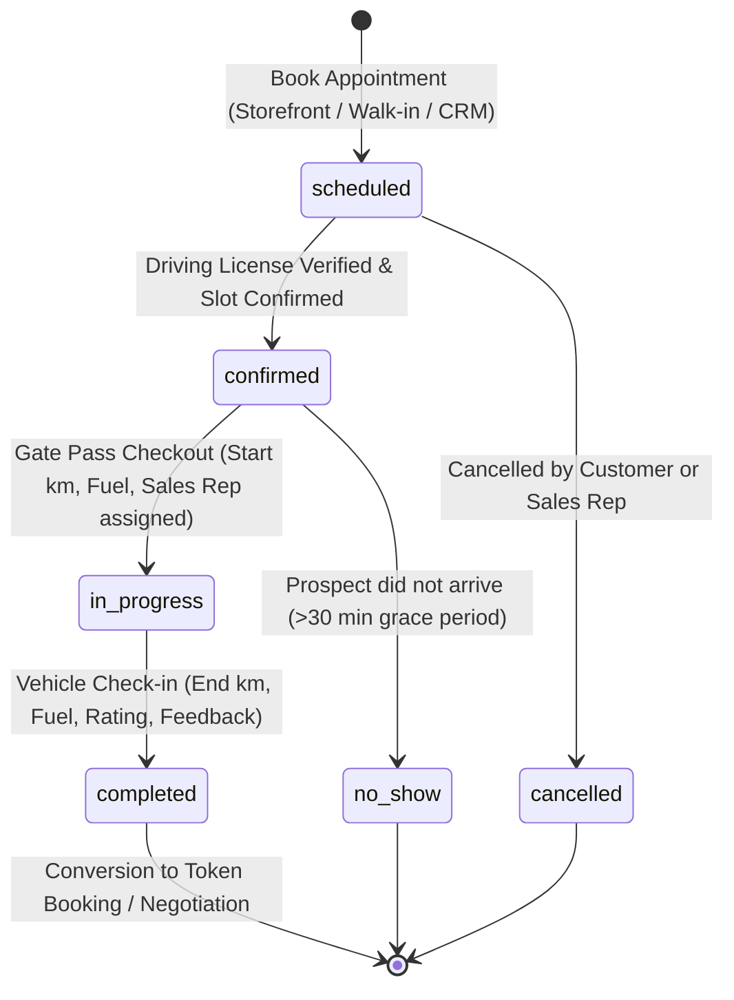

# Engineering Specification & Implementation Plan
# TEST DRIVE OPERATIONS & VEHICLE ROLLOUT (`/dashboard/test-drives`)
# ORGETISE — PRE-OWNED AUTOMOBILE DEALERSHIP SAAS

---

## 1. Executive Summary & Automotive Business Alignment

In pre-owned luxury automobile dealerships, a test drive is the single highest-intent conversion event in the sales funnel. When a customer steps onto the dealership lot to test-drive a Porsche 911, BMW M4, or Range Rover Defender, they have already evaluated market prices; they are assessing driving dynamics, vehicle mechanical sound, cabin condition, and dealership credibility.

Simultaneously, test drives present the dealership's highest operational and asset liabilities:
1. **High-Value Asset Risk**: Dispatching a ₹50L–₹2.5 Cr luxury vehicle onto public roads demands strict identity verification (Government Driving License verification and capture), odometer tracking, and physical condition checks.
2. **Showroom Floor Conflict**: A pre-owned dealership does not possess duplicate demo inventory. Every vehicle is a unique certified stock unit (`VIN` / registration number). Double-booking a vehicle across two prospective buyers destroys credibility and operational efficiency.
3. **Conversion Velocity & Sales Feedback**: The 15 minutes immediately following a test drive determine deal momentum. Capturing structured feedback (mechanical satisfaction, purchase interest tier: *Hot / Warm / Cold*, and immediate conversion action to Token Booking) is crucial for showroom closing ratios.

**Orgetise Test Drive Operations** is engineered specifically around these automotive realities:
- **Single-Showroom Architecture**: Fully tenant-isolated to the dealership's dedicated physical lot (`dealership_id`). Zero multi-branch complexity or inter-branch transfers (in strict accordance with `AGENTS.md` Rule 5.7).
- **End-to-End Rollout Lifecycle**: From appointment scheduling and DL capture to the digital **Showroom Gate Pass** (start km & fuel level) and post-drive return check-in.
- **Deep CRM Pipeline Integration**: Seamlessly syncs with `/dashboard/leads`, automatically transitioning linked leads from `interested` $\to$ `test_drive_scheduled` $\to$ `negotiation` / `booked`, appending audit entries to `lead_activities`.

---

## 2. Core Functional Requirements & Operational Lifecycle

### 2.1 The 6-Stage Test Drive State Machine



1. **`scheduled` (Appointment Booked)**:
   - Appointment created via Showroom Walk-in, Website Inquiry, or Sales Rep CRM action.
   - Tied to a specific live inventory vehicle (`vehicles.id`) and customer/lead (`leads.id`).
2. **`confirmed` (Customer Verified)**:
   - Customer Driving License (DL) details verified.
   - WhatsApp appointment reminder dispatched.
3. **`in_progress` (Vehicle On Road / Gate Pass Active)**:
   - Vehicle officially checked out from the showroom floor.
   - Starting odometer (km), starting fuel level, and accompanying sales executive logged.
   - Status updates vehicle availability indicator on showroom floor.
4. **`completed` (Vehicle Returned & Check-in)**:
   - Vehicle safely inspected and parked back on the showroom lot.
   - Return odometer recorded (total distance driven calculated).
   - Return fuel level recorded.
   - Customer purchase interest rating (*Hot / Warm / Cold*) and feedback notes captured.
   - Direct trigger to advance lead or open Token Booking deposit modal.
5. **`cancelled`**: Appointment cancelled prior to rollout (cancellation reason documented).
6. **`no_show`**: Customer failed to attend scheduled slot.

---

### 2.2 Dual Operational Views

To satisfy both managerial scheduling and showroom floor execution:

#### A. Interactive Timeline / Daily Schedule View
- Horizontal hour-by-hour timeline grid (09:00 AM – 08:00 PM) displaying vehicle reservations.
- Visual conflict prevention: Clear visual blocks highlight vehicle occupancy, preventing overlapping slot bookings for the same stock number.
- Quick drag/resize to adjust appointment times.

#### B. Pipeline Kanban / Status Cards View
- 5 operational columns:
  1. **Scheduled Today / Upcoming** (Awaiting customer arrival).
  2. **Confirmed & Ready** (DL verified, car prepped on floor).
  3. **Active on Road** (Currently out on test drive with gate pass active).
  4. **Completed Today** (Returned, feedback captured).
  5. **Archived / Cancelled / No-Show**.
- Cards display Vehicle Thumbnail, Registration Number, Customer Name & Phone, Assigned Salesperson, Time Slot, and Duration badge.

---

### 2.3 The Digital Gate Pass & Vehicle Rollout Slip

Prior to letting any vehicle leave the showroom premises, the system issues a **Digital Gate Pass**:
- **Customer Compliance**: Full Name, Phone Number, Driving License (DL) Number, and optional DL photo upload.
- **Vehicle Pre-Rollout Inspection**:
  - Current Odometer Reading (pre-filled with vehicle's recorded kilometers, confirmed by staff).
  - Fuel Gauge Level (`1/4`, `1/2`, `3/4`, `full`).
  - Physical Condition / Existing scratch note check.
- **Staff Accompaniment**: Assigned Sales Executive accompanying the drive.
- **One-Click Checkout**: Locks vehicle status and starts live drive timer.

---

### 2.4 Return Check-in & Post-Drive Conversion Drawer

Upon return to the showroom:
- **Return Mileage Check**: Ending Odometer reading $\to$ automatically calculates distance driven during the test drive (e.g. `+14 km`).
- **Return Fuel Level**: Verification against checkout fuel level.
- **Customer Purchase Intent**:
  - `Hot`: High intent, ready for deal negotiation or immediate token booking.
  - `Warm`: Liked the car, comparing with another model or awaiting spouse/financier approval.
  - `Cold`: Disliked dynamics, budget hesitation, or mismatched expectations.
- **Rating (1 to 5 Stars)** & Detailed Customer Feedback.
- **Next Direct Action**:
  - Button: **"Collect Token Booking"** $\to$ transitions lead directly to `booked`.
  - Button: **"Send Quotation & Finance Offer"** $\to$ transitions lead to `negotiation`.
  - Button: **"Schedule Follow-up Call"**.

---

## 3. Database Schema Design (PostgreSQL / Supabase)

To be created in migration `supabase/migrations/20261104000005_create_test_drives.sql`:

```sql
-- ────────────────────────────────────────────────────────────────────
-- TEST DRIVES SCHEMA
-- ────────────────────────────────────────────────────────────────────

CREATE TYPE test_drive_status AS ENUM (
  'scheduled',
  'confirmed',
  'in_progress',
  'completed',
  'cancelled',
  'no_show'
);

CREATE TYPE fuel_level AS ENUM (
  'reserve',
  'quarter',
  'half',
  'three_quarters',
  'full'
);

CREATE TYPE customer_interest_tier AS ENUM (
  'hot',
  'warm',
  'cold'
);

CREATE TABLE public.test_drives (
  id                     uuid PRIMARY KEY DEFAULT gen_random_uuid(),
  dealership_id          uuid NOT NULL REFERENCES public.dealerships(id) ON DELETE CASCADE,
  
  -- Relational Links
  vehicle_id             uuid NOT NULL REFERENCES public.vehicles(id) ON DELETE RESTRICT,
  lead_id                uuid REFERENCES public.leads(id) ON DELETE SET NULL,
  assigned_to            uuid REFERENCES public.profiles(id) ON DELETE SET NULL, -- Sales Executive
  
  -- Customer Details (Cached / Direct for walk-in drives without formal lead record)
  customer_name          text NOT NULL,
  customer_phone         text NOT NULL,
  customer_email         text,
  driving_license_number text,
  driving_license_url    text,
  
  -- Scheduling & Status
  status                 test_drive_status NOT NULL DEFAULT 'scheduled',
  scheduled_at           timestamptz NOT NULL,
  duration_minutes       integer NOT NULL DEFAULT 30,
  
  -- Vehicle Gate Pass & Rollout (Checkout)
  started_at             timestamptz,
  start_odometer_km      integer,
  start_fuel_level       fuel_level DEFAULT 'half',
  pre_drive_notes        text,
  
  -- Vehicle Return & Inspection (Check-in)
  completed_at           timestamptz,
  end_odometer_km        integer,
  end_fuel_level         fuel_level,
  post_drive_notes       text,
  
  -- Post-Drive Evaluation & Feedback
  customer_rating        smallint CHECK (customer_rating >= 1 AND customer_rating <= 5),
  customer_feedback      text,
  interest_tier          customer_interest_tier,
  next_step_action       text, -- e.g. "token_deposit", "finance_quote", "followup"
  
  -- Cancellation / Discard
  cancellation_reason    text,
  
  created_at             timestamptz NOT NULL DEFAULT now(),
  updated_at             timestamptz NOT NULL DEFAULT now()
);

-- Performance Indexes
CREATE INDEX test_drives_dealership_idx ON public.test_drives(dealership_id);
CREATE INDEX test_drives_vehicle_idx ON public.test_drives(vehicle_id);
CREATE INDEX test_drives_lead_idx ON public.test_drives(lead_id);
CREATE INDEX test_drives_schedule_idx ON public.test_drives(dealership_id, scheduled_at);
CREATE INDEX test_drives_status_idx ON public.test_drives(dealership_id, status);
CREATE INDEX test_drives_assigned_idx ON public.test_drives(dealership_id, assigned_to);

-- ────────────────────────────────────────────────────────────────────
-- ROW LEVEL SECURITY (RLS) POLICIES
-- ────────────────────────────────────────────────────────────────────
ALTER TABLE public.test_drives ENABLE ROW LEVEL SECURITY;

-- 1. Dealership members can view their showroom's test drives
CREATE POLICY "Members can view dealership test drives"
  ON public.test_drives FOR SELECT
  USING (dealership_id = public.get_my_dealership_id());

-- 2. Dealership staff can create test drive appointments
CREATE POLICY "Members can create test drives"
  ON public.test_drives FOR INSERT
  WITH CHECK (dealership_id = public.get_my_dealership_id());

-- 3. Dealership staff can update test drives (checkout, complete, cancel)
CREATE POLICY "Members can update test drives"
  ON public.test_drives FOR UPDATE
  USING (dealership_id = public.get_my_dealership_id());

-- 4. Dealership owners can delete test drives
CREATE POLICY "Owners can delete test drives"
  ON public.test_drives FOR DELETE
  USING (
    dealership_id = public.get_my_dealership_id()
    AND public.is_dealership_owner() = true
  );
```

---

## 4. TypeScript Contracts & Zod Validation Schemas

### 4.1 Domain Types (`packages/supabase/src/types.ts`)
Add `test_drives` table definition to `Database['public']['Tables']`, exporting:
```typescript
export type TestDriveStatus =
  | 'scheduled'
  | 'confirmed'
  | 'in_progress'
  | 'completed'
  | 'cancelled'
  | 'no_show';

export type FuelLevel =
  | 'reserve'
  | 'quarter'
  | 'half'
  | 'three_quarters'
  | 'full';

export type CustomerInterestTier = 'hot' | 'warm' | 'cold';
```

### 4.2 Zod Schemas (`apps/web/lib/validations/test-drives.ts`)

```typescript
import { z } from 'zod';

export const scheduleTestDriveSchema = z.object({
  vehicle_id: z.string().uuid("Please select a certified vehicle"),
  lead_id: z.string().uuid().optional().nullable(),
  customer_name: z.string().min(2, "Customer name is required"),
  customer_phone: z.string().min(10, "Valid phone number is required"),
  customer_email: z.string().email().optional().or(z.literal("")),
  driving_license_number: z.string().optional().or(z.literal("")),
  scheduled_at: z.string().datetime("Valid ISO appointment timestamp required"),
  duration_minutes: z.coerce.number().min(15).max(120).default(30),
  assigned_to: z.string().uuid().optional().nullable(),
  pre_drive_notes: z.string().optional(),
});

export const checkoutVehicleSchema = z.object({
  id: z.string().uuid(),
  start_odometer_km: z.coerce.number().min(0, "Odometer reading required"),
  start_fuel_level: z.enum(['reserve', 'quarter', 'half', 'three_quarters', 'full']),
  driving_license_number: z.string().min(4, "Driving license required for rollout"),
  driving_license_url: z.string().url().optional().or(z.literal("")),
  pre_drive_notes: z.string().optional(),
  assigned_to: z.string().uuid().optional().nullable(),
});

export const checkinVehicleSchema = z.object({
  id: z.string().uuid(),
  end_odometer_km: z.coerce.number().min(0, "Return odometer required"),
  end_fuel_level: z.enum(['reserve', 'quarter', 'half', 'three_quarters', 'full']),
  customer_rating: z.coerce.number().min(1).max(5).optional(),
  interest_tier: z.enum(['hot', 'warm', 'cold']).optional(),
  customer_feedback: z.string().optional(),
  next_step_action: z.string().optional(),
  post_drive_notes: z.string().optional(),
});
```

---

## 5. Server Actions & Business Logic Layer (`apps/web/app/dashboard/test-drives/actions.ts`)

### Key Server Actions:
1. `getTestDrivesAction(options)`:
   - Uses request-cached `getAuthenticatedContext()` from `@/lib/auth`.
   - Fetches test drives joined with `vehicles(id, brand, model, variant, registration_number, kilometers, asking_price, vehicle_media(url, is_hero))`, `leads(id, customer_name, status)`, and `profiles(id, full_name)`.
   - Computes live header KPIs:
     - **Today's Appointments**: Total drives scheduled for `CURRENT_DATE`.
     - **Active on Road**: Count with `status = 'in_progress'`.
     - **Completed This Week**: Count with `status = 'completed'` in the past 7 days.
     - **Conversion Rate**: $\frac{\text{Completed Drives with Hot Intent / Booked}}{\text{Total Completed}} \times 100$.
2. `scheduleTestDriveAction(formData)`:
   - Validates input with `scheduleTestDriveSchema`.
   - **Conflict Check**: Verifies the selected vehicle is not already scheduled or checked out in the requested time window.
   - Inserts record into `public.test_drives`.
   - If `lead_id` is supplied:
     - Automatically advances `leads.status` to `test_drive_scheduled`.
     - Logs entry in `public.lead_activities`: `"Test drive scheduled for [Car Brand Model] at [Time]"`.
   - Revalidates paths: `/dashboard/test-drives`, `/dashboard/leads`.
3. `checkoutVehicleAction(formData)`:
   - Issues Gate Pass. Validates DL and start km.
   - Updates `test_drives` status to `in_progress`, sets `started_at = now()`.
   - If linked lead exists, logs activity: `"Vehicle [Car] checked out for test drive. Gate pass issued."`.
4. `completeTestDriveAction(formData)`:
   - Validates return odometer (ensures `end_odometer_km >= start_odometer_km`).
   - Updates `test_drives` status to `completed`, sets `completed_at = now()`.
   - Updates vehicle current kilometers in `public.vehicles` if `end_odometer_km > vehicle.kilometers`.
   - If `interest_tier === 'hot'`, prompts or auto-advances lead stage to `negotiation`.
   - Logs comprehensive completion notes in `lead_activities`.
5. `cancelTestDriveAction(id, reason)`:
   - Sets status to `cancelled`, captures `cancellation_reason`.

---

## 6. UI/UX Architecture & Component Structure

Adheres to Orgetise's luxury design system: warm cream surfaces (`#FDFBF7`), deep obsidian accents (`#0A0A0A`), crisp border treatment (`border-neutral-200/80`), subtle badges, and zero UI clutter.

```
apps/web/
├── app/
│   └── dashboard/
│       └── test-drives/
│           ├── page.tsx                     # Server Component (auth & initial fetch)
│           ├── actions.ts                   # Fast server actions with getAuthenticatedContext
│           └── loading.tsx                  # Luxury skeleton loader
├── components/
│   └── test-drives/
│       ├── test-drives-shell.tsx            # View state orchestrator (Timeline vs Kanban, date pickers)
│       ├── test-drives-header.tsx           # KPI metrics (Today's Drives, Active on Road, Conversion Rate)
│       ├── test-drives-toolbar.tsx          # Date selector, Search, View switch, Status filter
│       ├── test-drives-timeline.tsx         # Hour-by-hour car schedule visualizer
│       ├── test-drives-kanban.tsx           # 5-stage card board with smooth transitions
│       ├── test-drive-card.tsx              # Rich appointment card (car image, DL tag, time, status)
│       ├── test-drive-status-badge.tsx      # Standardized status indicators
│       ├── test-drive-drawer.tsx            # Detailed inspection drawer with route/audit trail
│       └── modals/
│           ├── schedule-modal.tsx           # "Schedule Test Drive" appointment dialog
│           ├── gate-pass-modal.tsx          # "Issue Gate Pass / Checkout" rollout dialog
│           └── check-in-modal.tsx           # "Vehicle Check-in & Customer Feedback" dialog
```

### Key UI Features:
- **Vehicle Availability Warning**: When selecting a car in `schedule-modal.tsx`, shows an amber badge if already reserved in an adjacent slot.
- **Live "On Road" Pulsing Badge**: In the sidebar and kanban cards, active drives show a subtle pulsing emerald indicator: `● ON ROAD (24m)`.
- **WhatsApp Direct Reminders**: A direct click-to-chat button opens WhatsApp with pre-composed luxury appointment confirmation:
  *"Greetings Mr. Sharma, your test drive for the 2024 BMW M4 Competition is confirmed at Apex Motors for today at 4:30 PM. Our executive Rahul will receive you."*

---

## 7. Phased Implementation Roadmap

### Phase 1: Database Migration & Schema Setup
- Create `supabase/migrations/20261104000005_create_test_drives.sql`.
- Apply migration and update `packages/supabase/src/types.ts`.
- Seed 4 realistic luxury pre-owned test drives (e.g. Porsche 911 GT3 scheduled, BMW M4 on road, Defender completed).

### Phase 2: Server Actions & Business Logic
- Create `apps/web/app/dashboard/test-drives/actions.ts`.
- Implement `getTestDrivesAction` leveraging `getAuthenticatedContext()`.
- Implement `scheduleTestDriveAction`, `checkoutVehicleAction`, `completeTestDriveAction`, `cancelTestDriveAction`.
- Implement bidirectional sync with `public.leads` and `public.lead_activities`.

### Phase 3: Core UI (Header, Toolbar, Timeline & Kanban)
- Implement `test-drives-header.tsx` with live KPI computation.
- Implement `test-drives-toolbar.tsx` with date picker, search bar, and Timeline / Kanban switch.
- Build `test-drives-kanban.tsx` and `test-drive-card.tsx`.
- Build `test-drives-timeline.tsx` for hour-by-hour car schedule resolution.

### Phase 4: Gate Pass Checkout & Return Check-in Modals
- Build `schedule-modal.tsx` with live vehicle picker and lead linking.
- Build `gate-pass-modal.tsx` for start km, fuel gauge, and DL entry.
- Build `check-in-modal.tsx` for end km, fuel check, star rating, and customer interest tier (*Hot / Warm / Cold*).
- Build `test-drive-drawer.tsx` for deep dossier review.

### Phase 5: Verification & Production Quality Gates
- Execute `pnpm --filter web check-types` (0 errors).
- Execute `pnpm --filter web build` (successful compilation of `/dashboard/test-drives`).
- Verify multi-tenant RLS isolation: Ensure dealership staff only access their own showroom's test drives.

